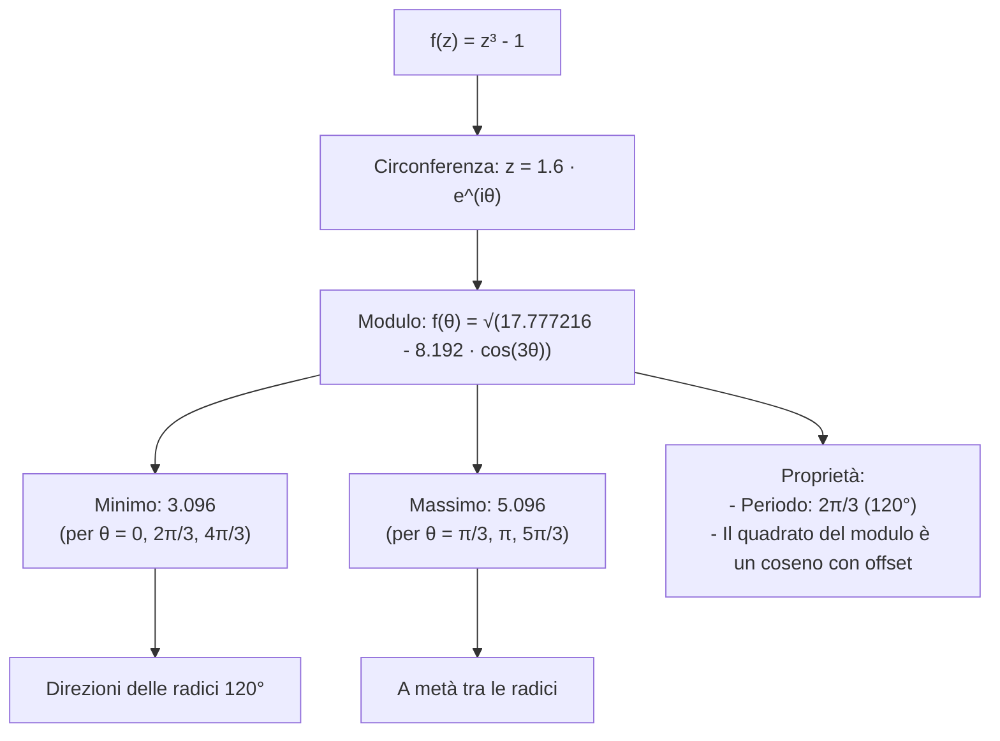
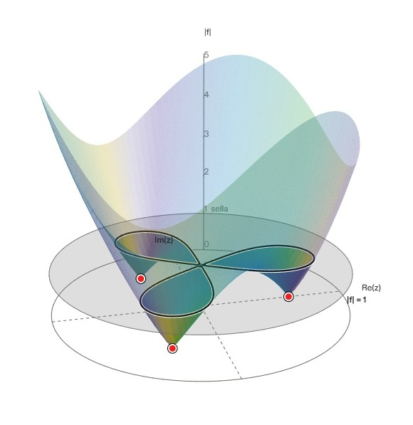
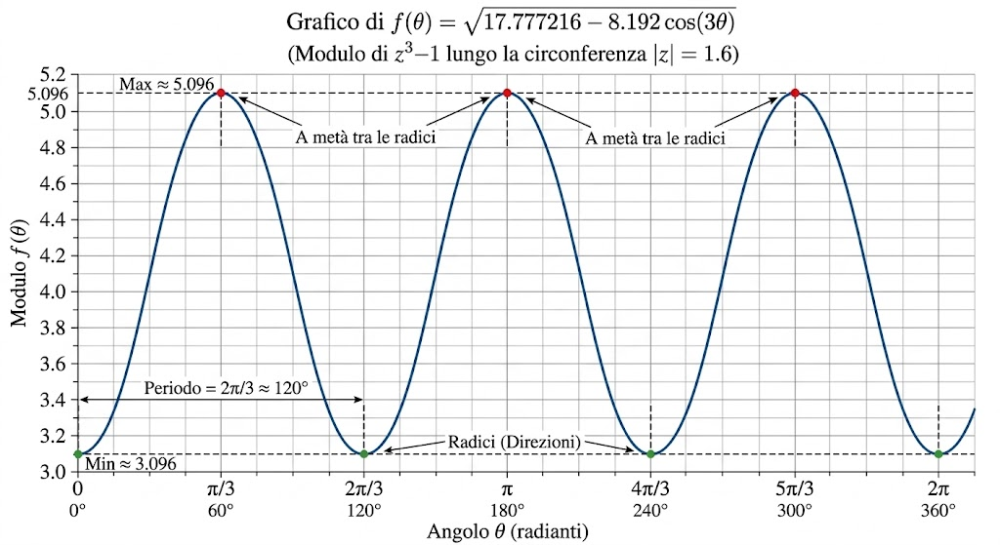
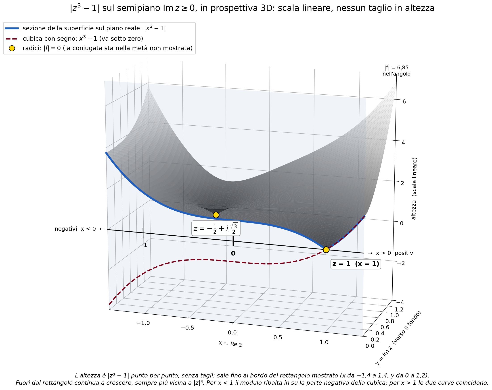
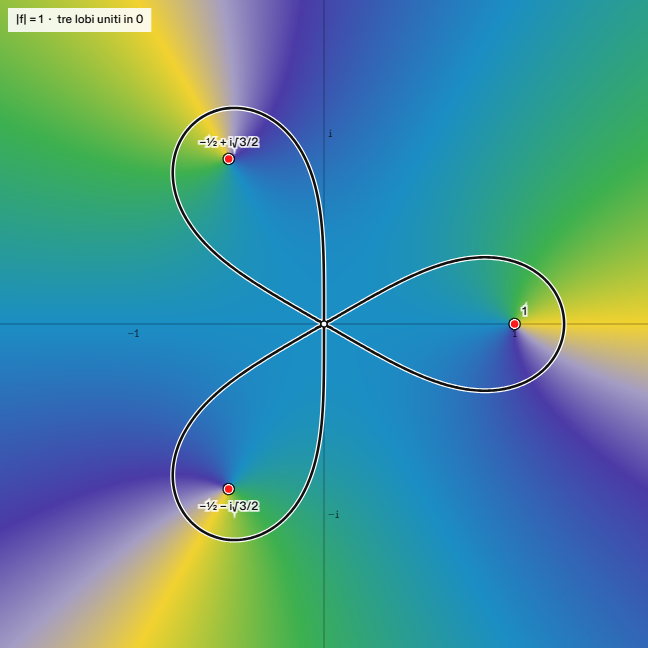
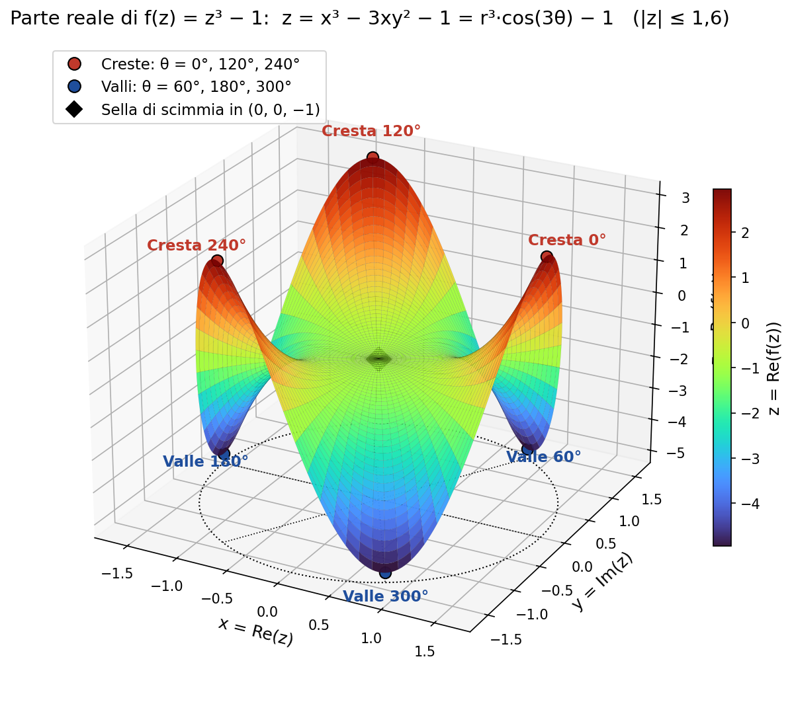
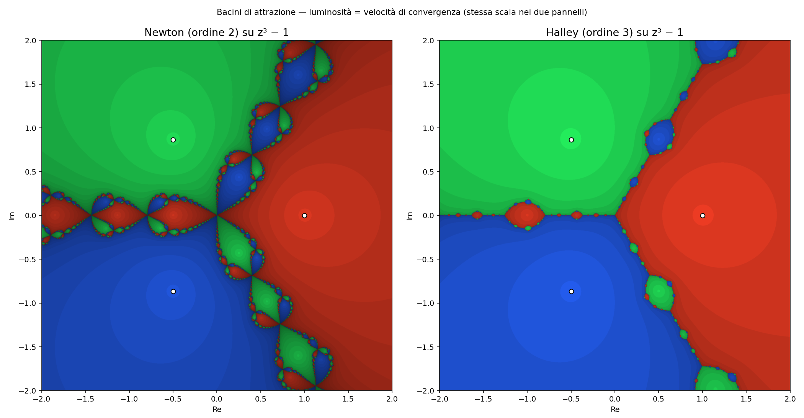

# Analisi del Modulo di $f(z) = z^3 - 1$ sulla Circonferenza di Raggio $1.6$

## Intercettiamo la curva della nostra cubica intercettandolo sul cilindo di raggio 1.6 sul piano di Gauss

## Dettagli Matematici

Per $f(z) = z^3 - 1$, lungo la circonferenza di raggio $1.6$ espressa in coordinate polari $z = 1.6 e^{i\theta}$, il modulo vale:

$$f(\theta) = \sqrt{17.777216 - 8.192 \cos(3\theta)}$$

(dove $\theta$ è espresso in radianti)

### Punti Estremi

- Minimo ($3.096$): per $\theta = 0, \frac{2\pi}{3}, \frac{4\pi}{3}$ (in corrispondenza delle direzioni delle radici).
- Massimo ($5.096$): per $\theta = \frac{\pi}{3}, \pi, \frac{5\pi}{3}$ (a metà strada tra le direzioni delle radici).

### Proprietà dell'andamento

Il periodo della funzione è $\frac{2\pi}{3}$ (pari a $120^\circ$). Il quadrato del modulo rappresenta un coseno con offset, mentre il modulo ne costituisce la radice quadrata.

### Riferimento Geometrico 3D

La funzione $f(\theta)$ rappresenta l'altezza del bordo (lungo la circonferenza di raggio $1.6$) della superficie tridimensionale mostrata nel grafico della cubica:

Nel grafico 3D, la funzione rappresenta il modulo per le coordinate $(x, y)$ di $f(x + i y) = z^3 - 1$ per tutti i punti appartenenti al cerchio $x^2 + y^2 = 1.6^2$.

## Grafico della cubica con sezione su piano reale

## Vista dall'alto

Il colore è la fase in ogni punto z; la linea nera è la curva |f| = 1. Attorno a ogni radice la fase fa un giro completo di colori.

Perché il cambio avviene a c = 1

Nell'**origine** c'è l'unico punto di sella del modulo, a quota 1.

f′(z) = 3z² si annulla solo in z = 0, e |f(0)| = |−1| = 1.

Vicino a 0, |f|² = 1 − 2·Re(z³) + |z|⁶: è una sella di scimmia, con tre valli verso le radici e tre creste in mezzo.

A c = 1 la curva passa per la sella e diventa tre lobi che si toccano nell'origine.

## Sella di scimmia

In matematica, la sella di scimmia (in inglese monkey saddle) è una superficie definita nello spazio tridimensionale dall'equazione cartesiana:$$z = x^3 - 3xy^2$$

In coordinate cilindriche $(r, \theta, z)$, la medesima superficie è rappresentata dalla forma:

$$z = r^3 \cos(3\theta)$$

### Origine del Nome

Il nome deriva da una visualizzazione geometrica:

mentre una sella tradizionale (da cavallo) possiede due depressioni contrapposte per le gambe del cavaliere, una sella progettata per una scimmia necessiterebbe di tre depressioni distinte — due per le gambe e una terza aggiuntiva per la coda.

### Proprietà Geometriche Principali

Punto critico: 

L'origine $(0,0,0)$ corrisponde a un punto stazionario degenere (un punto di sella cubico) in cui il gradiente della funzione si annulla.

Andamento radiale: 

A differenza di una sella standard (che mostra un minimo in alcune direzioni e un massimo in altre sul piano $xy$), la sella di scimmia presenta tre valli e tre creste alternate che si irradiano simmetricamente attorno all'origine, con un punto di flesso a tangente orizzontale in ogni direzione.

Simmetria: 

Possiede una simmetria rotazionale di ordine 3 rispetto all'asse verticale $z$.

# La cubica, i numeri complessi e i metodi di approssimazione

## 1. La cubica e la nascita dei numeri complessi

* **Scipione del Ferro (circa 1515):** Risolve le cubiche "depresse" (del tipo $x^3 + px = q$ o varianti prive del termine quadratico) e mantiene il metodo segreto. Antonio Maria Fior lo sfida nel 1535, ma Niccolò Tartaglia lo riscopre indipendentemente e sconfigge Fior. Nel 1539, Tartaglia confida il metodo a Girolamo Cardano sotto giuramento di segretezza.
* **Cardano, *Ars Magna* (1545):** Pubblica la formula risolutiva e nota che a volte compaiono radici quadrate di numeri negativi, anche quando le soluzioni dell'equazione sono tutte reali. Conosce l'equazione $x^3 = 15x + 4$, ma non la risolve direttamente con la formula radicale. Le sue prime operazioni esplicite con i numeri complessi compaiono in un problema di secondo grado (dividere $10$ in due parti il cui prodotto sia $40$, ovvero $5 \pm \sqrt{-15}$), e non nella cubica.
* **Bombelli, *L'Algebra* (1572):** È il primo a calcolare con i numeri complessi in modo coerente, stabilendo le regole algebriche dei segni per l'unità immaginaria. Per l'equazione $x^3 = 15x + 4$, la formula di Cardano fornisce la forma:
  $$\sqrt[3]{2 + \sqrt{-121}} + \sqrt[3]{2 - \sqrt{-121}}$$
  Siccome $(2 + i)^3 = 2 + 11i$, le due radici cubiche valgono $2 \pm i$ e la loro somma è $4$: la parte immaginaria sparisce miracolosamente. È proprio questo il passaggio cruciale discusso nel video.
* **Precedenti storici:** Erone di Alessandria (I secolo) aveva già compiuto un calcolo formale coinvolgendo la radice di un numero negativo, ma senza svilupparlo o riconoscerne la portata teorica. Per questo motivo, l'etichetta di "prima apparizione assoluta" va usata con cautela.
* **Il *casus irreducibilis*:** Quando una cubica possiede tre radici reali distinte, la formula algebrica con i radicali passa necessariamente attraverso i numeri complessi intermedi. La soluzione trigonometrica evita questo passaggio ed è strettamente collegata al problema classico della trisezione dell'angolo. Nell'esempio di Bombelli, le altre due radici reali sono $-2 \pm \sqrt{3}$.
* **La funzione $f(z) = z^3 - 1$:** Rappresenta un altro caso fondamentale. Ha una radice reale e due complesse coniugate ($1$ e $-\frac{1}{2} \pm \frac{\sqrt{3}}{2}i$), disposte simmetricamente sulla circonferenza unitaria rispettivamente a $0^\circ$, $120^\circ$ e $240^\circ$. Qui entra in gioco la trigonometria, ma non si tratta del *casus irreducibilis*.

---

## 2. Il Teorema Fondamentale dell'Algebra

Il percorso storico che ha condotto dai numeri reali a quelli complessi trova il suo coronamento concettuale nel **Teorema Fondamentale dell'Algebra**, dimostrato rigorosamente da Carl Friedrich Gauss nella sua tesi di dottorato del 1799. Il teorema stabilisce che ogni polinomio a coefficienti complessi di grado $n \ge 1$ possiede esattamente $n$ radici nel campo complesso, contando la loro molteplicità.

Questo risultato è di importanza capitale per tutto il contesto trattato: spiega perché polinomi come $z^3 - 1$ non si esauriscono mai nelle sole soluzioni reali (trovandone esattamente tre nel piano complesso) e giustifica la necessità di estendere i sistemi numerici. Senza i numeri complessi e la garanzia del teorema di Gauss, lo studio dei bacini d'attrazione, delle dinamiche iterative e delle singolarità delle funzioni polinomiali nei metodi numerici risulterebbe incompleto.

---

## 3. Storia del metodo di Newton

* **Antecedenti storici:** I Babilonesi miglioravano iterativamente la stima di una radice quadrata; Erone utilizzava un procedimento algebrico equivalente, mentre al-Kāshī disponeva di un metodo generale per le radici $n$-esime. Isaac Newton trasse probabilmente ispirazione da un metodo precedente di François Viète.
* **Newton, *De analysi* (scritto nel 1669, pubblicato nel 1711):** Lavora esclusivamente sui polinomi, operando senza l'ausilio delle derivate. Per risolvere l'equazione $y^3 - 2y - 5 = 0$:
  * parte da un'approssimazione iniziale $y \approx 2$ e pone $y = 2 + p$, ottenendo il polinomio in $p$: $p^3 + 6p^2 + 10p - 1 = 0$;
  * trascura le potenze superiori di $p$, riducendo l'equazione a $10p - 1 \approx 0$, da cui ricava $p \approx 0,1$;
  * pone successivamente $p = 0,1 + q$, ottenendo $q^3 + 6,3q^2 + 11,23q + 0,061 = 0$, da cui stima $q \approx -0,0054$, giungendo a $y \approx 2,0946$.
* **Prima stampa:** Nel 1685, all'interno del trattato di algebra di John Wallis. Nello stesso periodo, Seki Kōwa sviluppava un metodo analogo in Giappone.
* **Raphson (1690):** Semplifica l'approccio ricavando ogni correzione direttamente dal polinomio di partenza senza doverlo riscrivere a ogni passo, pervenendo a una formula iterativa sistematica.
* **Simpson (1740):** Formalizza il metodo nella notazione e veste moderna, introducendo esplicitamente l'uso della derivata prima.
* **Halley (1694, *Philosophical Transactions*):** Propone un metodo di terzo ordine che impiega anche la derivata seconda $f''(z)$.
* **Cayley (1879), *"The Newton–Fourier imaginary problem"*:** Osserva che nel piano complesso, a partire dal grado $3$ in poi, il comportamento del metodo di Newton si complica drasticamente. Da questa intuizione pionieristica nasce lo studio moderno dei frattali e dei bacini di attrazione.

---

## 4. Newton e Halley sul polinomio $z^3 - 1$

* **Le formule di iterazione:**
  * Metodo di Newton: $N(z) = \frac{2z^3 + 1}{3z^2}$
  * Metodo di Halley: $H(z) = \frac{z(z^3 + 2)}{2z^3 + 1}$ (la formula si semplifica direttamente in questa forma algebrica, evitando il calcolo esplicito e separato di $f''$).
* **Ordine di convergenza:** Vicino a una radice semplice, il metodo di Newton ha convergenza quadratica (ordine $2$), mentre quello di Halley ha convergenza cubica (ordine $3$). Questo spiega la maggiore rapidità di Halley, ma non determina la struttura geometrica dei confini.
* **Natura dei confini:** I confini dei bacini d'attrazione sono insiemi frattali per entrambi i metodi. Un ordine di convergenza superiore non elimina la natura frattale del bordo, che al massimo risulta visivamente meno frastagliato nelle zone di transizione.
* **Punti critici e singolarità:** 
  * Per Newton, l'origine $z = 0$ è un polo in cui la derivata si annulla ($f'(z) = 0$).
  * Per Halley, l'origine agisce come un punto fisso repulsivo, poiché in un intorno dello zero si ha $H(z) \approx 2z$. I poli di Halley si trovano dove $2z^3 + 1 = 0$, ovvero a una distanza di circa $0,794$ dall'origine.
* **Analisi visiva nel dominio $[-2, 2]^2$ (stessa scala di luminosità):**
  * Il metodo di Newton mostra una fitta catena di bulbi lungo i tre confini di separazione, con i tre colori dei bacini finemente annidati a ogni scala di ingrandimento.
  * Il metodo di Halley genera bacini visivamente più compatti, con un bordo geometricamente più regolare e lobi satelliti più radi e piccoli; la natura frattale torna tuttavia a manifestarsi chiaramente spingendo gli ingrandimenti a scale microscopiche.
  * Le zone chiare attorno alle radici (aree di rapida convergenza) risultano complessivamente più ampie con il metodo di Halley.
* **Confronto delle prestazioni (velocità di convergenza):**
  * Dati grafici empirici (tolleranza $10^{-9}$): media di $4,3$ iterazioni per Halley contro $7,4$ per Newton. I test computazionali confermano la tendenza (es. $3,84$ iterazioni contro $7,11$).
* **Riferimenti multimediali:**
  * Immagine: `newton-halley-z3-1.jpg` (salvata accanto al file `.md`) — *Didascalia:* Bacini di Newton (sinistra) e Halley (destra) per $z^3 - 1$.
  * Applicazione interattiva: *Esploratore di polinomi* — [URL-DA-INSERIRE].

---

## 5. Metodi numerici per la ricerca delle radici

* **Metodo di Bisezione:** Applicabile solo a funzioni reali, richiede un intervallo iniziale in cui la funzione cambia segno. È estremamente robusto e garantisce sempre la convergenza, ma risulta lento. È un procedimento antichissimo senza un singolo inventore noto.
* **Regula Falsi (Falsa Posizione):** Limitato al caso reale, è un metodo robusto ma in alcuni casi affetto da rallentamenti asintotici (stagnazione di un estremo). Storicamente documentato nelle tavolette babilonesi, nei papiri egizi, nei *Nove capitoli sull'arte matematica* cinesi (cap. 7) e nel *Liber Abaci* di Leonardo Fibonacci (1202).
* **Metodo delle Secanti:** Applicabile sia in campo reale che complesso, non richiede il calcolo delle derivate ed è più rapido della bisezione. Tuttavia, non offre garanzie formali di convergenza globale e genera anch'esso bacini d'attrazione frattali.
* **Metodo di Newton:** Valido nel campo reale e complesso, è un metodo di ordine $2$. Richiede la conoscenza della derivata prima, necessita di un'approssimazione iniziale vicina alla radice e rallenta in presenza di radici multiple. Produce i confini frattali più scenografici.
* **Metodo di Halley (1694):** Estensione a campo reale e complesso di ordine $3$. Richiede sia $f'$ che $f''$; i confini dei bacini mantengono una struttura frattale.
* **Metodo di Brent:** Metodo esclusivamente reale che combina sapientemente bisezione, secante e interpolazione quadratica inversa. È estremamente affidabile, rapido e non genera frattali. L'intuizione algoritmica originaria è dovuta a Dekker (1969), perfezionata da Richard Brent nel 1973 con l'aggiunta di protezioni di convergenza.
* **Metodi globali per tutte le radici complesse simultaneamente:** Algoritmi avanzati quali Durand–Kerner, Aberth e Jenkins–Traub, ideali per un approfondimento in capitoli successivi.

---

## 6. Fonti e riferimenti bibliografici

* **MacTutor History of Mathematics Archive:** Biografie e approfondimenti su Bombelli, Cardano e sulla storia delle equazioni algebriche di secondo, terzo e quarto grado.
* **Wikipedia (EN):** Voci di riferimento su *Ars Magna*, *Casus irreducibilis*, *Imaginary number*, *Newton's method (History)*, *Halley's method*, *Regula falsi*, *Brent's method*, *Newton fractal*.

