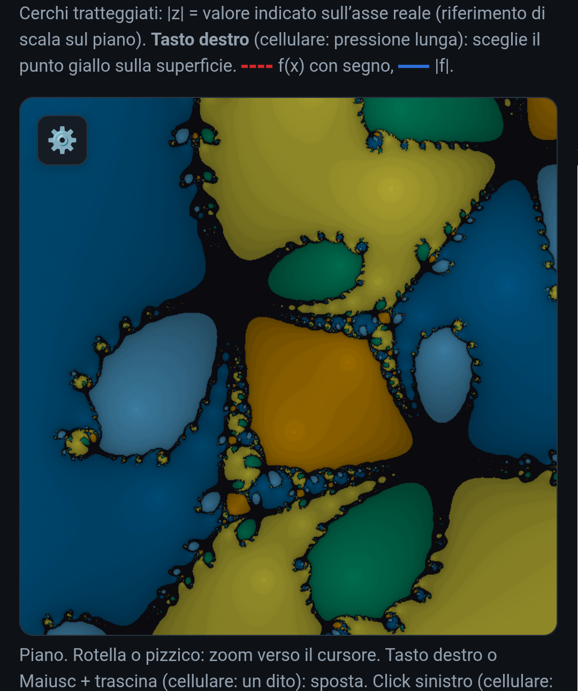

# Esploratore di polinomi f(z)

copyright: © 2026 Stefano Vesco (IK0VCK) - CatSW. All rights reserved.

- code name: **polinomi-fz**

## Manuale di bordo per giovani esploratori del piano complesso

> *«I numeri complessi sono uno strumento che ha fatto sembrare facile l'impossibile.»* — non è una citazione famosa, è la promessa di questo manuale. Alla fine ci crederai anche tu.

Ti hanno mai detto che l'equazione **x² + 1 = 0** «non ha soluzioni»? Beh, a scuola funziona così: *non ha soluzioni reali*. Ma ne ha **due**, e con questo strumento le puoi **vedere**, **afferrare** e **muovere** con il dito.

L'Esploratore di polinomi ti fa disegnare un polinomio qualunque (fino al grado 8, con coefficienti anche complessi) e lo trasforma in un **paesaggio**: montagne, valli, conche, passi di montagna e un arcobaleno che gira intorno agli zeri. Le radici non sono più numeri in una lista: sono *punti sulla mappa* dove il paesaggio tocca terra.

Questo manuale ti porta per mano, dal primo clic fino a un frattale. Puoi leggerlo in ordine o saltare alle **Esplorazioni** che ti incuriosiscono: ognuna è autonoma. Le **Missioni** alla fine sono per chi vuole mettersi alla prova.

## Indice

- [1. Che cosa puoi fare con questo strumento](#1-che-cosa-puoi-fare-con-questo-strumento)
- [2. Due minuti di numeri complessi](#2-due-minuti-di-numeri-complessi)
- [3. Come si può vedere una funzione complessa](#3-come-si-può-vedere-una-funzione-complessa)
- [4. Il tour dello strumento](#4-il-tour-dello-strumento)
- [5. Primi passi: la tua prima funzione](#5-primi-passi-la-tua-prima-funzione)
- [6. Esplorazione 1: le radici sono i punti dove la terra tocca il cielo](#6-esplorazione-1-le-radici-sono-i-punti-dove-la-terra-tocca-il-cielo)
- [7. Esplorazione 2: contare le radici](#7-esplorazione-2-contare-le-radici)
- [8. Esplorazione 3: dalle radici al polinomio](#8-esplorazione-3-dalle-radici-al-polinomio)
- [9. Esplorazione 4: simmetrie e coniugati](#9-esplorazione-4-simmetrie-e-coniugati)
- [10. Esplorazione 5: le curve di livello e i passi di montagna](#10-esplorazione-5-le-curve-di-livello-e-i-passi-di-montagna)
- [11. Esplorazione 6: l'asse reale e le costanti](#11-esplorazione-6-lasse-reale-e-le-costanti)
- [12. Esplorazione 7: il metodo di Newton e i suoi frattali](#12-esplorazione-7-il-metodo-di-newton-e-i-suoi-frattali)
- [13. Esplorazione 8: salvare, condividere, riprendere](#13-esplorazione-8-salvare-condividere-riprendere)
- [14. Missioni](#14-missioni)
- [15. Trucchi e scorciatoie](#15-trucchi-e-scorciatoie)
- [16. Se qualcosa non va](#16-se-qualcosa-non-va)
- [17. Glossario lampo](#17-glossario-lampo)
- [18. Per approfondire](#18-per-approfondire)

## 1. Che cosa puoi fare con questo strumento

Con l'Esploratore puoi:

- **vedere** dove sono le radici di un polinomio, comprese quelle complesse che sul quaderno restano invisibili;
- **costruire** un polinomio scegliendo le sue radici (e vedere i coefficienti che ne escono) oppure scegliendo i coefficienti (e vedere le radici che ne escono);
- **scoprire** perché un polinomio di grado *n* ha sempre *n* radici (il *Teorema fondamentale dell'algebra*);
- **seguire** le curve di livello di |f| e trovare i *punti di sella*, dove due «valli» si incontrano;
- **lanciare** il metodo di Newton da un punto qualsiasi e osservare i suoi **frattali**;
- **confrontare** una funzione prima e dopo una modifica, alternando **Annulla** e **Ripristina**;
- **salvare** tutto ciò che hai costruito in un testo (un JSON) e ritrovarlo identico un altro giorno;
- **condividere** la tua funzione e la tua vista con un semplice **link**, che chi lo riceve apre con un clic.

Funziona nel browser, senza installare nulla, sul computer e sul telefono: lo trovi online all'indirizzo `https://catsw.github.io/polinomi-fz/Esploratore_di_Polinomi.html`. Tutto si decide da una finestra sola, quella che si apre dal pulsante **f(z)** (lo incontrerai nella sezione 5).

## 2. Due minuti di numeri complessi

Un **numero complesso** si scrive `a + bi`, dove *a* e *b* sono numeri reali e *i* è un numero speciale con una sola regola: **i² = −1**.

Ogni numero complesso è un **punto di un piano**, il *piano di Gauss* (o di Argand-Gauss): *a* è la posizione orizzontale (**parte reale**), *b* quella verticale (**parte immaginaria**). I numeri reali stanno tutti sull'asse orizzontale, l'asse verticale è dedicato ai multipli di *i*.

Di ogni punto ti servono due informazioni:

| Nome | Che cos'è | Come si scrive |
|---|---|---|
| **Modulo** | la distanza dall'origine | \|a + bi\| = √(a² + b²) |
| **Fase** (o *argomento*) | l'angolo rispetto al semiasse reale positivo, in senso antiorario | arg(a + bi) |

Qualche esempio da tenere a mente:

| Numero | Dove sta | Modulo | Fase |
|---|---|---|---|
| `1` | a destra dell'origine | 1 | 0° |
| `i` | sopra l'origine | 1 | 90° |
| `−1` | a sinistra | 1 | 180° |
| `−i` | sotto | 1 | 270° (cioè −90°) |
| `1 + i` | in diagonale | √2 ≈ 1,41 | 45° |
| `3 + 4i` | | 5 | circa 53° |

Due fatti che useremo continuamente:

- il **coniugato** di `a + bi` è `a − bi`: il suo *specchio* rispetto all'asse reale;
- **moltiplicare per *i* significa ruotare di 90°** (provaci: 1 → *i* → −1 → −*i* → 1).

> 💡 **Prova a casa:** quanto vale i³? E i⁴? (Segui la rotazione di 90° per volta.)

Per un ripasso più completo, ci sono i link nella sezione 17.

## 3. Come si può vedere una funzione complessa

Una funzione complessa prende un punto *z* del piano e restituisce un altro punto *f(z)* del piano. Per disegnarla servirebbero **quattro dimensioni** (due in ingresso, due in uscita). Troppe per uno schermo! Il trucco usato da questo strumento è semplice e geniale:

> **L'altezza è il modulo |f(z)|. Il colore è la fase di f(z).**

Così ogni punto *z* del piano diventa un punto di una superficie: più alto dove |f| è grande, più basso dove è piccolo, e colorato in base alla *direzione* in cui punta il numero f(z).

Con la tavolozza standard («Attuale») la ruota dei colori è questa:

| Se f(z) è circa… | il colore è |
|---|---|
| `1` (fase 0°) | giallo |
| `i` (fase 90°) | verde |
| `−1` (fase 180°) | azzurro-blu |
| `−i` (fase 270°) | viola |

In mezzo, i colori sfumano con continuità: ogni giro completo dell'angolo è un giro completo della ruota dei colori.

### La regola d'oro

> **Dove la superficie tocca il piano (altezza zero) c'è una radice. E intorno a una radice si vedono tutti i colori.**

Perché? Perché vicino a una radice f(z) è un numero molto piccolo, e il suo piccolo vettore, mentre ti sposti intorno alla radice, gira su se stesso: la fase percorre tutto il cerchio, quindi **tutti i colori** si incontrano esattamente lì. Cerca i punti dove l'arcobaleno si «annoda»: sono le radici.

Questo modo di colorare le funzioni complesse si chiama *domain coloring* (link nella sezione 17).

## 4. Il tour dello strumento

### Le tre finestre

| Finestra | Cosa mostra | Cosa ci puoi fare |
|---|---|---|
| **Vista 3D** | La superficie |f(z)|, colorata con la fase. Dischi tratteggiati: |z| costante. Sull'asse reale, due curve: f(x) (rosso tratteggiato, con segno) e |f(x)| (blu). | Trascina per ruotare; rotella o pizzico per ingrandire. |
| **Piano di Gauss** | La mappa dall'alto: colore = fase, curve sottili = livelli di |f| (1, 2, 5, 10…), curva nera spessa = livello della *quota*. I pallini rossi numerati sono le radici. | Rotella o pizzico per zoomare verso il cursore; trascina (o tasto destro) per spostarti. |
| **Asse reale** | Il grafico «da scuola»: f(x) e |f(x)| per x reale. Pallini rossi = radici reali, cerchi = massimi e minimi relativi. | Rotella per zoomare; trascina per spostarti; **Zoom radici** per centrare sulle radici. |

Sotto le tre finestre trovi due riquadri: **Radici** (l'elenco `z0, z1, …` con valori e moduli) e **Punto scelto** (le informazioni sul punto giallo, quando i bacini di Newton sono attivi). Appena sopra c'è una riga di sintesi, per esempio *«Grado 3. Valori critici di |f| (sella): 1.000. |f| sopra l'ultimo valore critico: una sola curva chiusa che racchiude tutte le radici.»*

### I pulsanti importanti

- **Readme - Ver. x.y**, a destra del titolo in alto: apre in una nuova scheda il Readme su GitHub, punto d'accesso a questo manuale, alle note storiche, al changelog e alle note legali. Il numero è la versione dell'Esploratore che stai usando.
- **f(z)**, in basso a sinistra nella vista 3D: apre l'**editor della funzione** (sezione 5).
- **↶** e **↷**, subito a destra di f(z): **annullano** e **ripristinano** l'ultima conferma (sezione 5). Compaiono solo quando c'è qualcosa da annullare o da ripristinare.
- **⚙️ nella vista 3D**: i controlli della superficie.
- **⚙️ nel piano di Gauss**: i controlli del piano e dei bacini di Newton.
- **⛶** (angolo in alto a destra delle finestre): schermo intero per quella finestra.
- Solo su computer, in alto: **Disposizione** (le tre finestre su 1, 2 o 3 righe) e **Tutto schermo**.

### Il pannello ⚙️ della vista 3D

| Controllo | A che cosa serve |
|---|---|
| **Finestra R** | Quanto piano mostrare (il «raggio» della regione visibile). |
| **Quota \|f\|** | L'altezza del *piano grigio* che taglia la superficie. |
| **Altezza** | Quanto è «alta» la superficie (amplifica o appiattisce). |
| **Offset \|f\|** | Sposta il grafico in su o in giù nel riquadro. Doppio clic = ricalibra. |
| **Dominio** | *Radiale* (un disco) oppure *Cartesiano* (un quadrato). |
| **Metà Im z ≥ 0** | Mostra solo il semipiano superiore (vedi sezione 9). |
| **Sopra la quota** | La parte di superficie sopra il piano grigio: *piena*, *trasparente* o *nascosta*. |
| **Altezza logaritmica** | Comprime le altezze grandi, così si vedono anche i dettagli vicino alle radici. |
| **Curve reali nel 3D** | Mostra o nasconde f(x) e \|f(x)\| sopra l'asse reale. |
| **Rotazione** | Fa girare lentamente il grafico. |
| **Anima \|f\|** | Fa salire e scendere la quota avanti e indietro, da sola. |

### Il pannello ⚙️ del piano

| Controllo | A che cosa serve |
|---|---|
| **Bacini di Newton** | Attiva il metodo di Newton (sezione 12). |
| **Iterazioni** | Quanti passi del metodo di Newton si usano per colorare i bacini. |
| **Palette bacini** / **Palette fase** | Altre tavolozze di colori, anche pensate per chi ha difficoltà a distinguere i colori (*Okabe–Ito*). |
| **Bande di \|f\|** | Mostra le fasce di livello di |f|. |
| **Quota \|f\|** | Lo stesso slider della vista 3D. |
| **\|f\| = valore critico** | Porta la quota su un valore critico (a ogni clic passa al successivo). |
| **Passo di Newton**, **Riporta il punto** | Muovono il punto giallo (sezione 12). |
| **Tuffati nel punto giallo** / **nell'origine** | Uno zoom animato molto profondo. |
| **Vista intera** | Ripristina l'inquadratura del piano. |
| **Adatta R alle radici** | Sceglie una finestra che contenga tutte le radici. |

> 📱 **Sul telefono** le barre in alto non ci sono: tutto passa dai due ingranaggi e dal pulsante **f(z)**. Per scegliere il punto di Newton nel piano **tieni premuto** un istante (come per far comparire un menu); nella vista 3D lo stesso gesto, oppure il tasto destro del mouse su computer.

## 5. Primi passi: la tua prima funzione

Apriamo i motori in cinque mosse.

1. Nella **vista 3D**, in basso a sinistra, tocca **f(z)**. Si apre l'editor.
2. In fondo trovi quattro **Esempi**: tocca **z³ − z**.
3. Guarda l'editor: il selettore in alto ha tre modalità (*Forma normale*, *Forma a radici*, *Testo*). Non toccare ancora niente.
4. Premi **✓ Conferma** (in alto nell'editor).
5. Ecco il tuo primo paesaggio: tre radici reali (−1, 0, 1), tre colonne di pallini rossi sul piano, una superficie con tre «punte» che toccano terra.

### La regola della bozza

Quello che modifichi nell'editor resta in una **bozza**: finché non premi **✓ Conferma** le tre finestre non cambiano. Con **✕** esci scartando la bozza; se hai modificato qualcosa il programma ti chiede di premere ✕ una seconda volta, per evitare disastri.

Quando confermi una nuova funzione, lo strumento fa anche due regolazioni utili al posto tuo:

- sceglie una **Finestra R** che contenga tutte le radici;
- mette la **quota |f|** sopra l'ultimo valore critico e a metà strada con il massimo visibile di |f|: così all'inizio vedi subito il quadro d'insieme.

Se non ti piacciono, cambiale con gli slider dei pannelli ⚙️.

### Annulla e ripristina l'ultima conferma

Hai confermato una funzione e ti sei pentito? Subito a destra del pulsante **f(z)** compaiono due frecce curve:

| Pulsante | Scorciatoia | Che cosa fa |
|---|---|---|
| **↶** Annulla | **Ctrl+Z** | Torna alla funzione che c'era *prima* dell'ultima conferma. |
| **↷** Ripristina | **Ctrl+Y** | Riapplica la modifica che hai appena annullato. |

Passando il cursore sui pulsanti compare un suggerimento. Sulla tastiera funziona anche **Ctrl+Maiusc+Z** al posto di Ctrl+Y, e su Mac **⌘** al posto di Ctrl.

Come si comportano:

- **Si ricorda un solo passo**: l'ultima conferma. Una nuova conferma prende il posto della precedente.
- **Torna indietro più della sola formula.** Insieme alla funzione (coefficienti e radici) tornano anche i parametri di visualizzazione che la conferma aveva cambiato: la **Finestra R**, la **quota |f|** e l'**offset** scelti in automatico, oppure quelli contenuti in un JSON incollato. L'inquadratura del 3D che hai ruotato non viene toccata, salvo che la conferma l'abbia cambiata (un JSON con la camera).
- **I pulsanti compaiono solo se servono.** Appena aperto lo strumento non c'è niente da annullare, quindi non si vede nessuno dei due. Dopo una conferma compare **↶**; dopo un Annulla scompare **↶** e compare **↷**, e viceversa.
- **Con l'editor aperto sono spenti**, anche le scorciatoie: la bozza che stai scrivendo partiva dalla funzione attuale, e cambiarla sotto i tuoi piedi creerebbe confusione. Conferma o chiudi con ✕, poi usali.
- **Nelle caselle di testo** (per esempio la modalità Testo) Ctrl+Z continua ad annullare la digitazione, come in qualsiasi altro programma.
- Se premi **✓ Conferma** senza aver cambiato niente, non viene registrato nulla.

> 💡 **Prova subito:** nei primi passi di questa sezione hai confermato **z³ − z**. Premi **↶**: torni a **z³ − 1**, la funzione con cui lo strumento si apre. Premi **↷**: torna z³ − z. Ripeti avanti e indietro.

#### Confrontare prima e dopo

Annulla e Ripristina si scambiano lo stato: ogni volta che premi uno, l'altro ricorda la situazione che hai appena lasciato. Quindi puoi **alternarli quante volte vuoi** per osservare che cosa cambia dopo una modifica: le radici che si spostano, la superficie che si alza, i colori che girano. È utile soprattutto con piccole variazioni: confermi un coefficiente ritoccato (per esempio il `Im c₁ = 0,5` della sezione 9) e poi vai avanti e indietro con **Ctrl+Z** e **Ctrl+Y**, con gli occhi sul piano di Gauss.

Due cose da sapere:

- Se dopo un Annulla **trascini una radice** sul piano (**Sposta radice**), il Ripristino non è più disponibile: la tua nuova modifica ha preso il posto di quella annullata.
- Trascinare una radice non ha un Annulla suo: **↶** riporta la funzione a prima dell'ultima *conferma*, spostamenti compresi.

### Le regole del gioco

- Il grado massimo è **8**.
- I coefficienti possono essere **complessi**, tutti quanti.
- Una funzione **costante** (per esempio `f(z) = 1 + 2i`) è ammessa: è un piano orizzontale.
- La funzione **nulla** (f = 0 ovunque) no: non ha una fase da colorare.

## 6. Esplorazione 1: le radici sono i punti dove la terra tocca il cielo

### z² − 1 e z² + 1, due gemelli diversi

Apri **f(z)**, passa alla modalità **Testo**, scrivi `z^2 - 1` e premi **✓ Conferma**. Guarda le tre finestre:

- il grafico dell'**asse reale** è una parabola (blu) che scende a zero in x = −1 e x = 1: due pallini rossi;
- il **piano** mostra due radici numerate z0 e z1, sull'asse orizzontale;
- il **3D** mostra la superficie che tocca il piano grigio in due punti.

Ora scrivi `z^2 + 1` e conferma. Sorpresa:

- nel grafico dell'asse reale la curva blu **non tocca mai lo zero**: il suo minimo è 1, in x = 0 (ecco perché al liceo si dice «nessuna soluzione reale»);
- ma nel piano e nel 3D ci sono **due radici**: `+i` e `−i`, esattamente sopra e sotto l'origine. Il box **Radici** le chiama `0.000 + 1.000i` e `0.000 − 1.000i`.

> 🎯 **Idea chiave:** le radici complesse sono lì anche quando il grafico reale non le mostra. Con questo strumento le vedi.

### Quanti giri fa il colore?

Scrivi, uno alla volta, `z`, poi `z^2`, poi `z^3`, e per ognuno guarda il **piano** intorno all'origine. Muovi lo sguardo in cerchio attorno al centro e conta quante volte rivedi tutta la ruota dei colori.

| Funzione | Giri di colore attorno all'origine |
|---|---|
| `z` | 1 |
| `z^2` | 2 |
| `z^3` | 3 |

La radice è sempre in 0, ma più la funzione è «ripida» intorno a quella radice, più veloce gira la fase. In generale, intorno alla radice di `z^n` i colori compiono **n giri**. Questo numero *n* è la **molteplicità** della radice, e lo ritroveremo.

## 7. Esplorazione 2: contare le radici

### Il teorema che non fallisce mai

> **Teorema fondamentale dell'algebra.** Ogni polinomio di grado *n* ≥ 1, anche con coefficienti complessi, ha **esattamente *n* radici complesse**, se ogni radice si conta tante volte quanta è la sua molteplicità.

Tutti i polinomi a coefficienti reali che hai incontrato a scuola e che «non avevano soluzioni» le avevano, eccome: stavano nel piano complesso.

### Le potenze di una radice: i poligoni

Prova con `z^3 - 1`, `z^4 - 1`, `z^5 - 1`, `z^6 - 1`, `z^8 - 1`. Cosa noti nel piano?

Le radici di `z^n − 1` si dispongono ai vertici di un **poligono regolare con *n* lati**, inscritto nella circonferenza di raggio 1. Con z³−1 un triangolo, con z⁴−1 un quadrato, con z⁸−1 un ottagono. Il box **Radici** mostra sempre **esattamente *n*** elementi: il teorema in azione.

### Radici doppie

Carica l'esempio **(z−1)²(z+1)** (o scrivi `(z-1)^2(z+1)`). Il grado è 3, quindi 3 radici: −1 e **1 contata due volte**. Nel box Radici compaiono tre righe: `z0 = −1`, `z1 = 1`, `z2 = 1`. Nel piano le due radici coincidenti sono *un solo* pallino, un po' più grande, con etichetta **1–2** (cioè «le radici numero 1 e 2»).

> 💡 Nel 3D la superficie tocca il piano in 1 «più dolcemente» che in −1: la radice doppia è piatta, perché lì |f| scende *quadraticamente*.

Quante radici *distinte* può avere un polinomio di grado 8? Da 1 (provaci con `(z-1)^8`) a 8.

## 8. Esplorazione 3: dalle radici al polinomio

Finora hai dato un polinomio e hai visto le radici. Adesso facciamo il contrario: **scegli le radici** e lascia che lo strumento costruisca il polinomio.

Nell'editor passa a **Forma a radici**. Ogni pagina descrive una radice con tre ingredienti:

- la radice **a** (con i suoi due slider: parte reale `Re a` e immaginaria `Im a`);
- una **molteplicità m** (quante volte la radice compare);
- un **coefficiente di scala a′** (parti `Re a′` e `Im a′`), diverso da zero.

Il polinomio è il prodotto: **f(z) = ∏ a′ · (z − a)^m**, con una pagina per ogni radice distinta. Il coefficiente a′ è un *fattore di scala*: moltiplicandosi con quelli delle altre pagine fissa il coefficiente direttivo di tutto il polinomio.

Le radici si numerano **z0, z1, …**: la pagina 1 comprende z0 (e z1 se m = 2, con etichetta tipo `z0–z1`), e così via. Lo stesso numero indica la stessa radice nel piano e nel box Radici.

### Gli strumenti per aggiungere radici

| Pulsante | Che cosa fa |
|---|---|
| **+ Radice** | Aggiunge una radice nuova (m = 1, a′ = 1). |
| **🗑** | Diminuisce m di 1; se m = 1 elimina la pagina. L'ultima radice non si può cancellare. |
| **Coniugata** | Aggiunge il **coniugato** della radice corrente (lo specchio rispetto all'asse reale). |
| **Opposta** | Aggiunge l'**opposto** −a (lo specchio rispetto all'origine). |
| **Dal piano** | L'editor si nasconde: **tocca un punto del piano di Gauss** e quella diventa la nuova radice (arrotondata a due decimali). |

Il grado totale (la somma delle molteplicità) non supera mai **8**: quando lo raggiungi, i pulsanti di aggiunta si spengono.

### Laboratorio: costruire (z−1)(z+2)(z²+1)

1. **f(z)** → **Forma a radici**. Imposta la prima radice `Re a = 1`.
2. **+ Radice** e imposta `Re a = −2`.
3. **+ Radice** e imposta `Im a = 1` (la radice è `i`), poi tocca **Coniugata**: arriva `−i`.
4. Premi **✓ Conferma**. Il box Radici mostra −2, 1, `i`, `−i`.
5. Riapri **f(z)** → **Forma normale**. I coefficienti sono già lì: **c₄ = 1, c₃ = 1, c₂ = −1, c₁ = 1, c₀ = −2**, cioè z⁴ + z³ − z² + z − 2. (Controlla a mano: (z−1)(z+2) = z²+z−2, per z²+1 dà proprio questo.)

> 🎯 Hai appena fatto, a occhio, un'espansione di polinomi che a scuola richiede un foglio intero.

### Che cosa fa a′?

Torna in Forma a radici e prova a cambiare solo `a′`:

- **Re a′ = 2**: la superficie si alza (tutti i moduli raddoppiano), le radici non si muovono;
- **Im a′ = 1, Re a′ = 0** (cioè a′ = *i*): le radici restano ferme, la superficie ha la stessa forma, ma **tutti i colori ruotano di 90°**.

Moltiplicare la funzione per un numero complesso fa due cose: ne **scala il modulo** e ne **ruota la fase**. Ne parliamo ancora nella sezione 11.

## 9. Esplorazione 4: simmetrie e coniugati

### Con coefficienti reali, le radici complesse vengono a coppie

Scrivi `z^2 + 2z + 5`. Le radici sono **−1 + 2i** e **−1 − 2i**: una il coniugato dell'altra, simmetriche rispetto all'asse orizzontale. Non è un caso: **se un polinomio ha coefficienti reali e *a + bi* è una radice, lo è anche *a − bi***. (Per questo i polinomi di grado dispari a coefficienti reali hanno sempre almeno una radice reale: le complesse vengono in coppie e ne avanza una.)

Tutto il paesaggio è simmetrico: il semipiano sotto l'asse è lo specchio di quello sopra. È la ragione per cui esiste il controllo **Metà Im z ≥ 0**: mostra solo la metà superiore, tanto l'altra è identica.

### Rompi la simmetria

1. Parti da `z^3 - 1` (tre radici: una reale e due coniugate).
2. Apri **f(z)** → **Forma normale**, vai alla pagina **c₁** e porta **Im c₁** a 0,5.
3. Conferma.

Cosa succede? Le tre radici si spostano e **non sono più simmetriche** rispetto all'asse reale. Il controllo **Metà Im z ≥ 0** si spegne (grigio): non ha più senso, perché con coefficienti non reali le due metà non sono più uno specchio dell'altra.

### Radici opposte

Il polinomio `z^4 - 5z^2 + 4` ha soltanto potenze pari: se *a* è una radice, lo è anche **−a**. Le sue radici sono ±1 e ±2. Nell'editor, il pulsante **Opposta** esiste per costruire apposta queste coppie.

## 10. Esplorazione 5: le curve di livello e i passi di montagna

Il piano grigio nella vista 3D è la **quota**: l'altezza a cui tagli la superficie. Dove la taglia, nel piano di Gauss compare la **curva nera spessa**: i punti con |f(z)| esattamente uguale alla quota.

### Che aspetto ha una curva di livello?

Carica `z^3 - 1` e muovi lo slider **Quota |f|** da piccolo a grande.

- Quota **piccola** (per esempio 0,5): la curva nera è fatta da **tre cerchietti**, uno intorno a ciascuna radice. Sono tre «isole» sotto la quota.
- Quota che cresce: i cerchietti si ingrandiscono... fino a un momento preciso (quota = **1**) in cui **si toccano tutti e tre nell'origine**.
- Quota **maggiore di 1**: ora c'è **una sola curva chiusa** che racchiude tutte le radici.

Il valore 1 si chiama **valore critico**, e il punto in cui le curve si toccano, **punto critico** (qui è l'origine, dove la derivata `f′(z) = 3z²` si annulla). Nel paesaggio è un **passo di montagna**, una *sella*: sale da una parte e scende dall'altra.

La riga sopra le finestre lo dice con parole tue: *«|f| sotto il primo valore critico: 3 curve chiuse separate, una per radice»* oppure *«|f| sopra l'ultimo valore critico: una sola curva chiusa…»*.

### Più selle, più valori critici

Prova con `z^4 - 5z^2 + 4`. Qui i valori critici sono **due**: 2,250 e 4,000 (la riga di sintesi li elenca). Usa il pulsante **|f| = valore critico** nel pannello del piano: a ogni clic la quota va sul valore critico successivo, e vedi due «isole» fondersi proprio al clic giusto.

> 🔭 **Un fatto bello:** i punti critici di un polinomio (gli zeri di f′) stanno **sempre dentro il più piccolo poligono convesso che contiene le radici**. È il *teorema di Gauss–Lucas*. Controllalo sul piano: i passi di montagna non vanno mai fuori dal «recinto» delle radici.

### Gli strumenti per giocare con le quote

- **Anima |f|** fa oscillare da sola la quota: vedi le curve di livello respirare, fondersi e separarsi.
- **Sopra la quota**: scegli se la parte di superficie sopra il piano grigio è *piena*, *trasparente* o *nascosta* (nascondila e vedi solo le «valli» sotto la quota).
- **Altezza logaritmica**: spegnila e guarda cosa succede alle radici (le punte diventano meno evidenti, i picchi molto più alti).
- **Bande di |f|**: nel piano, le fasce chiaro-scure marcano i livelli |f| = 1, 2, 5, 10, 20…; le etichette ti dicono i valori.

## 11. Esplorazione 6: l'asse reale e le costanti

### Il grafico che conosci

La terza finestra mostra l'asse reale: scegli `z^3 - z`.

- La curva **rossa tratteggiata** è f(x) *con il segno*: sale e scende come i grafici di scuola.
- La curva **blu** è |f(x)|: il valore assoluto, sempre sopra lo zero.
- I **pallini rossi** sono le radici reali: −1, 0, 1.
- I **cerchi** sono massimi e minimi relativi di f(x).

Rotella per zoomare, trascina per spostarti, **Zoom radici** per centrarti sulle radici.

Se un coefficiente ha parte immaginaria, f(x) non è più un numero reale: *massimo* e *minimo* non hanno più senso (non si possono ordinare i numeri complessi) e i cerchi spariscono. Resta solo il modulo |f(x)|.

### Le funzioni costanti: piani colorati

Scrivi `1` e conferma. Il paesaggio diventa un **piano orizzontale** alla quota |f| = 1, tutto dello stesso colore: giallo, la fase 0. Poi prova a scrivere `i`, `−1`, `−i`.

| f(z) | Quota | Colore |
|---|---|---|
| `1` | 1 | giallo |
| `i` | 1 | verde |
| `-1` | 1 | azzurro |
| `-i` | 1 | viola |
| `2` | 2 | giallo (più alto) |
| `1 + i` | √2 ≈ 1,41 | tra giallo e verde (fase 45°) |

Stesso modulo, fase diversa: **stessa altezza, colore diverso**. Quote e colori sono le due metà dell'informazione di un numero complesso, e qui le vedi separate.

### Moltiplicare per un numero complesso

Ora confronta `z^2 - 1` con `i(z^2 - 1)`. Forma identica, radici identiche, ma il secondo ha tutti i colori **ruotati di 90°**: *i* ha modulo 1 (non cambia l'altezza) e fase 90° (ruota i colori). Con `2i(z^2 - 1)` raddoppi anche le altezze.

## 12. Esplorazione 7: il metodo di Newton e i suoi frattali

### L'idea

Come si trova una radice senza risolvere l'equazione? **Il metodo di Newton**: parti da un punto *z*, disegni la tangente alla funzione, vedi dove la tangente incontra lo zero, e ripeti da lì. In formula:

> **z → z − f(z) / f′(z)**

Funziona meravigliosamente... quasi sempre. Ed è sul «quasi» che nascono i frattali.

### Come si attiva

Ci sono due modi equivalenti:

- apri il **⚙️ del piano** e spunta **Bacini di Newton**;
- oppure, nel riquadro **Punto scelto**, clicca sulle parole blu **Attiva la spunta**.

Poi **clicca nel piano** (sul telefono: *tieni premuto un istante*) per piazzare il **punto giallo**: da lì parte il metodo di Newton, con il suo percorso disegnato. Il riquadro **Punto scelto** scrive le coordinate. **Passo di Newton** lo fa avanzare di un passo, **Riporta il punto** lo rimette dov'era.

### I bacini

Con i bacini attivi, ogni punto del piano prende il colore della **radice a cui Newton lo porta**, partendo da lì. Un «bacino di attrazione» è l'insieme dei punti che finiscono nella stessa radice. Il cursore **Iterazioni** decide quanti passi si usano per decidere.

Esperimenti:

1. `z^2 - 1`. Due colori, divisi da una linea **perfettamente retta**: l'asse verticale. Chi parte a destra va a 1, chi parte a sinistra va a −1.
2. `z^2 + 1`. Stesso disegno, ma ruotato: ora la retta è l'asse orizzontale, e le radici sono ±*i*.
3. `z^3 - 1`. **Sorpresa**: tre bacini, ma il confine non è più una linea. È un **frattale**: ingrandendo, riappaiono gli stessi arabeschi, all'infinito. Esiste un punto *z* dove tutti e tre i colori si toccano? Quanti ce ne sono?

Perché succede? Vicino ai punti dove `f′(z) = 0` (i passi di montagna della sezione 10), la tangente è quasi orizzontale: il punto successivo viene lanciato *lontanissimo*, in una direzione imprevedibile. Lì, un piccolo spostamento di partenza cambia la radice di arrivo.

### Tuffati!

Con i bacini attivi, premi **Tuffati nel punto giallo** (o **Tuffati nell'origine**). L'inquadratura si infila nel frattale con uno zoom animato di circa mille volte. Guarda i dettagli: spirali, copie in miniatura dell'insieme di partenza, bordi che non diventano mai lisci.

### Radici doppie, Newton lento

Carica `(z-1)^2(z+1)`, piazza il punto giallo vicino a 1 e premi più volte **Passo di Newton**: vicino a una radice doppia il metodo **avanza molto più lentamente** (dimezza la distanza ad ogni passo invece di raddoppiare le cifre esatte). La molteplicità si sente anche nei numeri.

> 📺 *Per vedere un frattale di Newton raccontato come si deve, cerca su YouTube il video di 3Blue1Brown sui frattali di Newton.*

## 13. Esplorazione 8: salvare, condividere, riprendere

### La modalità Testo

Nell'editor, la terza modalità è **Testo**: una casella dove scrivere il polinomio come lo scriveresti a mano.

| Puoi scrivere… | …intendendo |
|---|---|
| `z^3 - 1`, `z3 - 1`, `z³ - 1` | z³ − 1 |
| `(0.5 + 3.4i)z2 - 1.73i` | un coefficiente complesso e un termine noto immaginario |
| `2z^2 + 3,5` | la virgola vale come punto decimale |
| `(z-1)^2(z+1)` | un prodotto: viene espanso da solo |
| `i(z^2 - 1)` | moltiplicazione per *i* |

Premi **Interpreta** (o direttamente **✓ Conferma**): se la formula è sbagliata, il messaggio ti dice *che cosa* non va e *dove* (la posizione è evidenziata nella casella), e la tua formula resta lì da correggere. Gli errori più comuni: parentesi non chiusa, un grado maggiore di 8, un simbolo non riconosciuto.

### Il salvataggio

Nella modalità Testo, il pulsante **Esporta JSON** copia negli appunti un testo con **tutto**: la funzione (coefficienti e radici) e l'aspetto (finestra R, quota, altezza, palette, dominio, bacini di Newton, inquadratura del 3D e del piano…). Incollalo dove vuoi: nelle note, in un'e-mail, in un messaggio ai compagni, in un file di testo. Somiglia a questo:

```json
{
  "app": "polinomi-fz",
  "version": "1.1",
  "f": {
    "formula": "z3 − 1",
    "coeffs": [[-1, 0], [0, 0], [0, 0], [1, 0], [0, 0], …],
    "roots": [ … ]
  },
  "view": { "R": 1.8, "level": 2, "domain": "polar", … }
}
```

Il campo `version` dice con quale versione del formato è stato scritto il file (ora **1.1**). I file salvati con le versioni precedenti (1.0) si caricano senza problemi; se il file è più recente del programma, i campi sconosciuti vengono ignorati e un avviso te lo segnala.

### Il ripristino

Un altro giorno: apri l'Esploratore, **f(z)** → **Testo**, **incolla il JSON** e premi **Interpreta** poi **✓ Conferma**. Ritrovi la stessa funzione e lo stesso paesaggio, identici, senza rimettere a mano nessun coefficiente.

### Condividere con un link

Il JSON è completo ma scomodo da mandare in giro. Quando vuoi solo dire a qualcuno «guarda che bella», c'è il **link**.

Nell'editor, in modalità **Testo**, subito a destra di **Esporta JSON** trovi **Condividi questa vista**. Premilo: negli appunti finisce un indirizzo di questo tipo:

```
https://catsw.github.io/polinomi-fz/Esploratore_di_Polinomi.html#v=eyJhcHAiOiJwb2xpbm9taS1meiIs…
```

Chi lo apre, dal computer o dal telefono, vede **subito** la tua funzione con la tua vista (finestra R, quota, altezza, offset, dominio, tavolozze, bacini di Newton, inquadratura del 3D e del piano, punto giallo): niente da incollare, niente da confermare. La parte dopo `#v=` è la configurazione codificata e resta nel browser: non viene inviata al server della pagina.

Qualche cosa da sapere:

- **Il link non sostituisce il JSON.** Contiene la funzione (i coefficienti) e i parametri di vista, ma non la forma a radici. Se avevi costruito la funzione a radici, chi apre il link trova la stessa funzione, ma con i coefficienti *a′* ridistribuiti (il coefficiente direttivo va sul primo fattore, gli altri valgono 1). Per conservare tutto, usa **Esporta JSON**.
- **Condivide la bozza così com'è**, anche se non l'hai ancora confermata, come fa Esporta JSON. Con la funzione nulla il pulsante non è disponibile.
- **Quanto è lungo?** Da circa 700 a circa 1300 caratteri, secondo la funzione: va bene per un messaggio o un'e-mail. Se per qualche motivo ti arriva troncato, la via sicura resta il JSON.
- **Il link si apre nel browser**: non va incollato nell'editor, dove serve invece il JSON.
- **Aprire un link non si può annullare** con **↶**: lo strumento non ricorda la funzione con cui si era aperto.
- **Se il link non è valido** (per esempio copiato a metà), sotto il sottotitolo compare un avviso rosso e lo strumento parte con la vista predefinita; con un clic sull'avviso lo chiudi. Lo stesso accade se il link contiene la funzione nulla.
- **Se usi lo strumento da un file sul tuo computer**, il link punta comunque all'indirizzo pubblico su GitHub Pages: chi lo apre vede la versione pubblicata, che potrebbe essere diversa dalla tua.
- **Se gli appunti non sono disponibili**, il link appare nella casella di testo già selezionato: copialo con Ctrl+C.

> 🎒 **Idea per la classe:** ognuno costruisce la sua funzione più bella, esporta il JSON e lo manda a un compagno con una sola domanda: *«Quante radici ha? Indovina prima di incollare.»* Oppure, più comodo, mandagli il link di **Condividi questa vista**: si apre da solo.

## 14. Missioni

Per ogni missione prova prima da solo; poi apri la soluzione.

**Missione 1 — Il quadrato.** Costruisci un polinomio le cui radici siano i vertici di un quadrato centrato nell'origine, con due vertici sull'asse reale.

<details><summary>Soluzione</summary>

`z^4 - 1` (radici 1, *i*, −1, −*i*). Anche in Forma a radici: 1, poi **Coniugata** non serve; usa **+ Radice** per `i` e **Coniugata** per `−i`, e **Opposta** per −1.
</details>

**Missione 2 — Il triangolo capovolto.** Rispetto a `z^3 − 1` (che ha una radice a destra), trova un polinomio con una radice a *sinistra* e le altre due a destra.

<details><summary>Soluzione</summary>

`z^3 + 1`: radici −1 e 0,5 ± 0,866*i*.
</details>

**Missione 3 — Il pentagono.** Dai un polinomio di grado 5 con le radici ai vertici di un pentagono regolare.

<details><summary>Soluzione</summary>

`z^5 - 1`. (Controlla che la radice reale sia 1 e che le altre quattro siano a coppie di coniugati.)
</details>

**Missione 4 — Radice tripla.** Con `(z-1)^3`, quante radici elenca il box Radici? Quanti giri di colore fa la fase intorno a 1?

<details><summary>Soluzione</summary>

Tre (z0, z1, z2, tutte uguali a 1) e tre giri. Nel piano un solo pallino con etichetta `0–2`.
</details>

**Missione 5 — Nessuna radice reale.** Trova un polinomio di grado 2 a coefficienti reali la cui curva blu sull'asse reale **non tocchi mai lo zero**, con le radici complesse a −2 ± *i*.

<details><summary>Soluzione</summary>

(z − (−2 + i))(z − (−2 − i)) = (z + 2)² + 1 = `z^2 + 4z + 5`.
</details>

**Missione 6 — Due passi di montagna.** In `z^4 - 5z^2 + 4`, trova i due valori critici usando il pulsante **|f| = valore critico**. Quanto valgono? In che punti del piano si trovano le selle?

<details><summary>Soluzione</summary>

I valori sono 2,25 e 4. Il valore 4 è |f(0)|: l'origine. Il valore 2,25 è |f(±√2,5)| con ±√2,5 ≈ ±1,58: due selle sull'asse reale, tra le radici 1 e 2 (e tra −1 e −2).
</details>

**Missione 7 — Il colore giusto.** Quale funzione costante dà un piano alla quota 3, di colore viola?

<details><summary>Soluzione</summary>

Il viola è la fase di −*i*: serve modulo 3 e fase di −*i*: `-3i`.
</details>

**Missione 8 — Simmetria spezzata.** Parti da `z^2 - 1`: quante e quali modifiche ai coefficienti bastano a far spegnere «Metà Im z ≥ 0»? Dove vanno a finire le radici?

<details><summary>Soluzione</summary>

Basta rendere non nullo un solo coefficiente immaginario: per esempio Im c₁ = 0,5 (cioè `z^2 + 0,5i z - 1`). Le due radici non sono più simmetriche rispetto all'asse reale.
</details>

**Missione 9 — Il confine dritto.** Per quali polinomi di grado 2 il confine fra i due bacini di Newton è una retta? Come è fatto?

<details><summary>Soluzione</summary>

Per **tutti** quelli di grado 2 con due radici distinte: il confine è la **perpendicolare al segmento che unisce le radici, nel punto medio** (l'asse del segmento). Provalo con `z^2 - 1`, `z^2 + 1` e `(z-1)(z-3)`.
</details>

**Missione 10 — Caccia al frattale.** Trova un polinomio di grado ≤ 5 il cui bordo dei bacini di Newton sia, a tuo giudizio, il più bello. Esporta il JSON e confrontalo con quello dei compagni.

## 15. Trucchi e scorciatoie

| Se vuoi… | Fai così |
|---|---|
| Ruotare la vista 3D | Trascina (un dito o il mouse) |
| Ingrandire | Rotella o pizzico con due dita |
| Spostare il piano o il grafico dell'asse reale | Trascina; sul piano anche il tasto destro |
| Scegliere un punto sul piano per Newton | Clic; sul telefono tocco prolungato |
| Scegliere un punto sulla superficie 3D | Tasto destro; sul telefono tocco prolungato |
| Centrare il grafico 3D nel riquadro | Slider **Offset |f|**; doppio clic = valore calibrato |
| Vedere tutte le radici | **Adatta R alle radici** (⚙️ del piano) o slider **Finestra R** |
| Tornare a un'inquadratura pulita | **Vista intera** (⚙️ del piano) |
| Passare da una radice all'altra nell'editor | Le frecce **◀ ▶** o il menu a tendina; su computer anche le frecce ← → della tastiera |
| Scartare le modifiche non ancora confermate | **✕** (premilo due volte se la bozza è modificata) |
| Mandare a qualcuno la tua funzione e la tua vista | **f(z)** → **Testo** → **Condividi questa vista**, poi incolla il link |
| Aprire il Readme (manuale, changelog, note legali) | Pulsante **Readme - Ver. x.y** accanto al titolo |
| Annullare l'ultima funzione confermata | **↶** (a destra di f(z)) oppure **Ctrl+Z** |
| Ripristinare la modifica annullata | **↷** oppure **Ctrl+Y** |
| Confrontare prima e dopo una modifica | Dopo la conferma, alterna **Ctrl+Z** e **Ctrl+Y** |

## 16. Se qualcosa non va

**Il pulsante ✓ Conferma è grigio.** Leggi il messaggio rosso nell'editor: o la funzione è nulla (tutti i coefficienti a zero), o un coefficiente *a′* è zero in Forma a radici.

**La modalità Forma a radici non si apre.** Succede se la funzione è costante (non ha radici da elencare) o è nulla. Scrivi una funzione di grado almeno 1.

**«Metà Im z ≥ 0» è grigio.** Almeno un coefficiente ha parte immaginaria diversa da zero: le due metà non sono più simmetriche, quindi la scorciatoia non ha senso.

**Non vedo le radici.** Prova **Adatta R alle radici** o aumenta **Finestra R** (massimo 10). Se hai una radice molto lontana dall'origine, potresti doverla cercare con il piano ingrandito al minimo.

**Ho modificato i coefficienti ma niente cambia.** Ricorda la bozza: finché non premi **✓ Conferma** le finestre non si aggiornano.

**Il grafico 3D è troppo in basso/alto, o è tagliato quando lo ruoto.** Muovi lo slider **Offset |f|** nel pannello ⚙️ della vista 3D, o riduci lo zoom con la rotella.

**Newton non fa niente.** Controlla che la spunta **Bacini di Newton** sia attiva (o clicca sulle parole blu *Attiva la spunta* nel riquadro Punto scelto).

**Ho confermato la funzione sbagliata.** Premi **↶** (o Ctrl+Z): torni a quella di prima, con la vista com'era. Se ti accorgi dell'errore dopo una seconda conferma, la prima non si recupera: si ricorda un solo passo.

**I pulsanti ↶ e ↷ non ci sono.** È normale: compaiono solo quando c'è qualcosa da annullare o da ripristinare. Appena aperto lo strumento, o dopo aver premuto ✓ Conferma senza cambiare niente, non c'è nulla da annullare.

**I pulsanti ↶ e ↷ sono grigi, o Ctrl+Z non fa niente.** L'editor di f(z) è aperto (o stai scegliendo una radice dal piano): chiudilo con **✕** o confermalo. Se il cursore è dentro una casella di testo, Ctrl+Z annulla la digitazione invece della funzione: clicca fuori dalla casella.

**Il Ripristino (↷) è sparito.** L'hai perso trascinando una radice sul piano dopo l'Annulla, oppure con una nuova conferma.

**«Condividi questa vista» dice «non disponibile».** La funzione è nulla (tutti i coefficienti a zero) oppure, in Forma a radici, un coefficiente *a′* è zero: correggi e riprova.

**Apro un link e vedo la vista predefinita con un avviso rosso.** Il link è incompleto o rovinato (capita se viene troncato o se se ne copia solo una parte): chiedi di rimandartelo, o fatti mandare il JSON.

**Il link non si apre uguale a come lo vedeva chi l'ha mandato.** Ricorda che il link porta la funzione e la vista ma non la forma a radici, e che chi lo ha creato da un file locale ti manda alla versione pubblicata su GitHub Pages.

**Ho chiuso tutto e ho perso la mia funzione.** Se non hai salvato un JSON (o un link), torna a scriverla nella modalità Testo: dalla formula leggibile nel box in alto ritrovi i coefficienti.

## 17. Glossario lampo

| Termine | In due parole |
|---|---|
| **Numero complesso** | `a + bi`, con i² = −1; un punto del piano. |
| **Parte reale / immaginaria** | *a* e *b* in `a + bi`. |
| **Modulo** | La distanza dall'origine: √(a² + b²). |
| **Fase (argomento)** | L'angolo rispetto all'asse reale positivo. |
| **Coniugato** | `a − bi`; lo specchio rispetto all'asse reale. |
| **Polinomio, grado** | Somma di termini cₖ·zᵏ; il grado è l'esponente più alto con coefficiente non nullo. |
| **Radice (zero)** | Un valore *z* con f(z) = 0. |
| **Molteplicità** | Quante volte una radice compare nella fattorizzazione. |
| **Derivata f′** | La «pendenza» di f; nei polinomi si ottiene abbassando di uno gli esponenti. |
| **Punto critico, valore critico** | Un punto dove f′ = 0, e il valore di |f| in quel punto. |
| **Sella** | Un punto critico che è un passo di montagna: sale da un lato e scende dall'altro. |
| **Curva di livello** | Tutti i punti dove |f| ha lo stesso valore. |
| **Bacino di attrazione** | L'insieme dei punti da cui il metodo di Newton arriva alla stessa radice. |
| **Frattale** | Una figura con dettagli simili a tutte le scale di ingrandimento. |

## 18. Per approfondire

Una piccola biblioteca per curiosi (le pagine di Wikipedia sono in inglese: molte voci hanno una versione italiana, la trovi nel menu delle lingue).

**Per i numeri complessi e il piano di Gauss**

- [Numero complesso (Wikipedia)](https://en.wikipedia.org/wiki/Complex_number)
- [Piano complesso (Wikipedia)](https://en.wikipedia.org/wiki/Complex_plane)
- [Appunti in italiano su numeri complessi, piano di Gauss e forma trigonometrica](https://www.math.unipd.it/~moresco/complessi.pdf) (Università di Padova)

**Per capire i colori**

- [Domain coloring (Wikipedia)](https://en.wikipedia.org/wiki/Domain_coloring): la tecnica che usa questo strumento.
- [Domain coloring: pagina interattiva](https://complex-analysis.com/content/domain_coloring.html), con tante funzioni da esplorare.

**Per le radici dei polinomi**

- [Teorema fondamentale dell'algebra (Wikipedia)](https://en.wikipedia.org/wiki/Fundamental_theorem_of_algebra)
- [Sul Teorema Fondamentale dell'Algebra](https://digilander.libero.it/granieri/algebra-granieri-mathesis.pdf): una dimostrazione scritta in italiano pensata per studenti di scuola secondaria.
- [Teorema di Gauss–Lucas (Wikipedia)](https://en.wikipedia.org/wiki/Gauss%E2%80%93Lucas_theorem): dove stanno i punti critici.
- *Per i più avventurosi (livello universitario):* una [spiegazione «elettrostatica»](https://arxiv.org/pdf/2112.00110) del teorema di Gauss–Lucas, di John Baez.

**Per Newton e i frattali**

- [Metodo di Newton (Wikipedia)](https://en.wikipedia.org/wiki/Newton's_method)
- [Frattale di Newton (Wikipedia)](https://en.wikipedia.org/wiki/Newton_fractal)
- [Insieme di Julia (Wikipedia)](https://en.wikipedia.org/wiki/Julia_set): i «parenti stretti» dei frattali di Newton.
- Il video di **3Blue1Brown** sui frattali di Newton (cercalo su YouTube).

### Replica una scena del video nell'esploratore

Guarda il video [Newton’s fractal (which Newton knew nothing about)  @ 13:16](www.youtube.com/watch?v=-RdOwhmqP5s)

poi sull'esploratore, vai su f(z), modalità Testo ed inserisci il json sottostante (Conferma):

```json
{
  "app": "polinomi-fz",
  "version": "1.0",
  "f": {
    "formula": "z5 + z2 − z + 1",
    "coeffs": [[1,0],[-1,0],[1,0],[0,0],[0,0],[1,0],[0,0],[0,0],[0,0]],
    "roots": [{"a":[-1.324717957244746,0],"ap":[1,0],"m":1},{"a":[-1.2313859658275321e-17,-1],"ap":[1,0],"m":1},{"a":[-4.274090772323957e-18,1],"ap":[1,0],"m":1},{"a":[0.662358978622373,0.5622795120623012],"ap":[1,0],"m":1},{"a":[0.662358978622373,-0.5622795120623012],"ap":[1,0],"m":1}]
  },
  "view": {
    "R": 1.8,
    "level": 12.951909412214912,
    "height": 1,
    "offset": 0.07,
    "domain": "polar",
    "halfPlane": false,
    "aboveLevel": "gh",
    "phasePalette": "att",
    "bands": true,
    "logHeight": true,
    "realCurves3D": true,
    "autoRotate": false,
    "animate": false,
    "layout": "1",
    "newton": {"on":true,"iterations":20,"basinPalette":"oi"},
    "camera": {"yaw":-0.7,"pitch":0.85,"zoom":1},
    "plan": {"cx":-0.9558744318819785,"cy":0.2610766404022212,"scale":0.0002998544597777399},
    "probe": [-0.10113093551377106,1.061603819535056]
  }
}
```
Noti le zone nere nella vista sul piano di Gauss? Sono dei punti che convergono con un numero di iterazioni del metodo di Newton > 20. Se apri il pannello dei settaggi premendo il pulsante della rotella ed aumenti il numero di iterazioni vedrai la parte nera colorarsi.



### Differenza tra limite di calcolo e limite matematico

Ci sono casi in cui alcuni dei punti sul piano di Gauss non convergono, anche aumentando il numero delle iteazioni.
Esplora il seguente esempio intorno all'origine:

```json
{
  "app": "polinomi-fz",
  "version": "1.0",
  "f": {
    "formula": "z3 − 2·z + 2",
    "coeffs": [[2,0],[-2,0],[0,0],[1,0],[0,0],[0,0],[0,0],[0,0],[0,0]],
    "roots": [{"a":[-1.7692923542386314,0],"ap":[1,0],"m":1},{"a":[0.8846461771193157,0.5897428050222054],"ap":[1,0],"m":1},{"a":[0.8846461771193157,-0.5897428050222054],"ap":[1,0],"m":1}]
  },
  "view": {
    "R": 2.4,
    "level": 11.254435684287936,
    "height": 1,
    "offset": 0.07,
    "domain": "polar",
    "halfPlane": false,
    "aboveLevel": "gh",
    "phasePalette": "att",
    "bands": true,
    "logHeight": true,
    "realCurves3D": true,
    "autoRotate": false,
    "animate": false,
    "layout": "1",
    "newton": {"on":true,"iterations":20,"basinPalette":"oi"},
    "camera": {"yaw":-0.7,"pitch":0.85,"zoom":1},
    "plan": {"cx":0.1783794558243904,"cy":-0.11720977538854505,"scale":2.799501992889243},
    "probe": [0.5724148296582102,1.0989538220574282]
  }
}
```

---

*Manuale scritto per l'Esploratore di polinomi f(z), versione 1.1. Buone esplorazioni, e ricordati: dove i colori si annodano, c'è una radice.*
