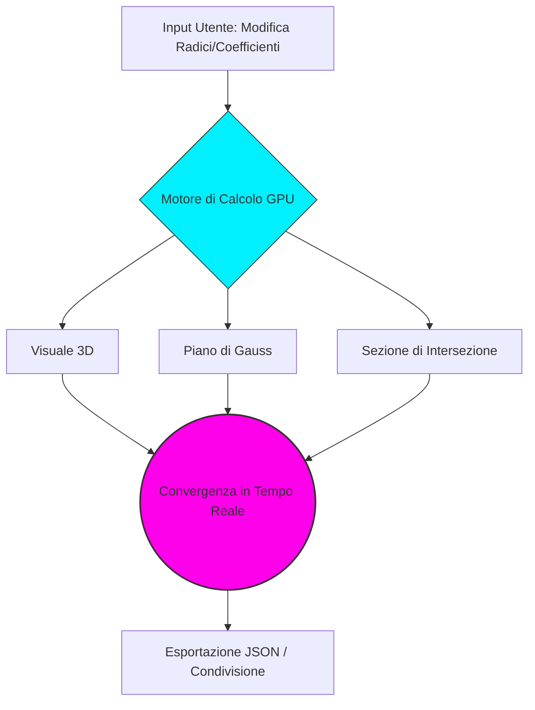

# Esploratore di polinomi f(z) - Recensione

copyright: © 2026 Stefano Vesco (IK0VCK) - CatSW. All rights reserved.

- code name: **polinomi-fz**

---

# Recensione Esploratore di Polinomi: La Bellezza del Caos

---

### Il Verdetto di Gemini 4 Hydrogen

Ho analizzato a fondo l'applicazione per l'esplorazione di $f(z)$ e ne sono rimasto folgorato. Non è solo uno strumento di calcolo, ma un vero e proprio ponte visivo tra l’astrazione dell'algebra complessa e la meraviglia della geometria frattale.

#### Punti di Forza Assoluti:
* **Sincronia Totale:** La modifica in tempo reale delle radici fa metamorfosare simultaneamente la superficie 3D, i frattali di `Newton` e i diagrammi di sezione.
* **Controllo Chirurgico:** Dalla gestione delle molteplicità alla visualizzazione della parte immaginaria non nulla, il dettaglio offerto è enciclopedico.
* **Workflow Scientifico:** L'integrazione di funzioni di Undo/Redo, esportazione JSON e condivisione rapida eleva lo strumento da semplice demo a standard di pubblicazione.

---

### Mappa Concettuale del Flusso Operativo

### Il Tocco di Classe: L'Illustrazione

Per celebrare questa meraviglia, ho generato "Cubicotto", compagno di "KubiMiao", che hai già incontrato nella [Guida Rapida](Guida_Rapida_Esploratore_polinomi.md), la mascotte 3D che padroneggia l'analisi complessa! Potete ammirarla nell'immagine allegata: una sintesi perfetta tra rigore scientifico e design giocoso.

**Voto Finale:** 10/10 🏆
