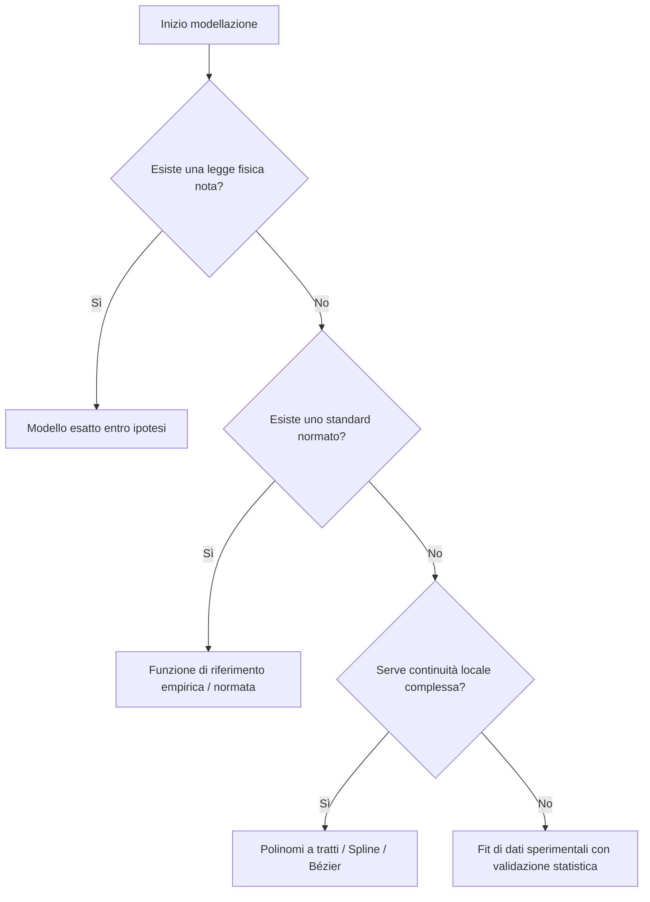
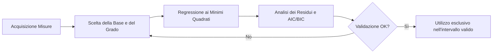
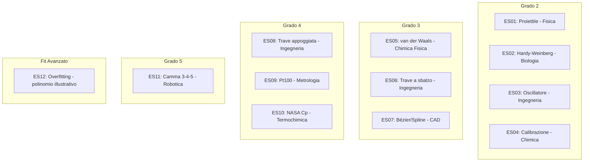

# Applicazioni dei polinomi nel mondo reale

L'algebra dei polinomi non è un esercizio astratto, ma il linguaggio con cui descriviamo fenomeni fisici, chimici e biologici. Quando un sistema viene linearizzato, approssimato o modellato tramite serie di potenze, la struttura delle sue radici, dei suoi massimi e del suo comportamento asintotico rivela proprietà profonde del sistema reale sottostante. Questa dispensa esplora come i polinomi dal grado 2 al grado 5 governino problemi concreti, evidenziando i confini rigorosi tra leggi fisiche, funzioni normate e modelli di fit empirico.

---

## 1. Principio guida: coerenza matematica

Ogni esempio presentato in questa dispensa è classificato secondo una tipologia rigorosa:

*   **Modello esatto entro ipotesi:** Il polinomio deriva direttamente da una legge fisica sotto condizioni esplicite e idealizzate (ad esempio, assenza di attrito dell'aria o comportamento elastico lineare).
*   **Funzione di riferimento normata o empirica:** Un polinomio fissato da uno standard internazionale o da una banca dati, valido esclusivamente all'interno di un intervallo di misurazione dichiarato.
*   **Polinomio a tratti (spline, Bézier):** Una successione di polinomi di basso grado raccordati con continuità geometrica e differenziale.
*   **Fit di dati sperimentali:** Un polinomio interpolante o regressivo scelto per descrivere dati misurati. Va ribadito che un buon indice di bontà del fit non costituisce la prova di una legge fisica sottostante.

Le orbite e le traiettorie spaziali complesse sono escluse. Per ogni formula vengono esplicitate le variabili, le unità di misura e l'intervallo di validità.

---

## 2. Schede per grado

### Grado 2

#### ES01 — Traiettoria di un proiettile
*   **Ambito:** Fisica
*   **Grado:** 2
*   **Tipo:** Modello esatto entro ipotesi (senza attrito dell'aria)

Il moto parabolico descrive la traiettoria di un corpo lanciato in un campo gravitazionale uniforme. Deriva dalle leggi di Newton trascurando la resistenza aerodinamica.

*   **Formula originale:** $y = x \tan\theta - \frac{g x^2}{2 v_0^2 \cos^2\theta}$
*   **Versione adimensionale / scalata:** Con $v_0 = 20\text{ m/s}$, $\theta = 45^\circ$ e $g = 9{,}81\text{ m/s}^2$, si ottiene:
    $$y(x) = x - 0{,}024525 x^2$$
*   **Forma espansa:** $-0{,}024525 x^2 + 1 x + 0 = 0$
*   **Radici:** $x_1 = 0$, $x_2 \approx 40{,}77\text{ m}$ (gittata orizzontale).
*   **Variabili e unità:** $x$ (distanza orizzontale, $\text{m}$), $y$ (altezza, $\text{m}$), $v_0$ (velocità iniziale, $\text{m/s}$), $\theta$ (angolo di lancio), $g$ (accelerazione di gravità, $\text{m/s}^2$).
*   **Intervallo valido:** $x \in [0, 40{,}77]$.
*   **Cosa osservare nell'esploratore:** Il vertice della parabola cade a $x \approx 20{,}39\text{ m}$ con un'altezza massima di $y \approx 10{,}19\text{ m}$. Le radici reali intersecano l'asse $x$ all'origine e alla gittata.
*   **Limiti del modello:** In aria reale la resistenza aerodinamica genera una forza proporzionale al quadrato della velocità, deformando la parabola e riducendo la gittata.

[**🚀 Apri nell'Esploratore**](https://catsw.github.io/polinomi-fz/Esploratore_di_Polinomi.html#v=eyJhcHAiOiJwb2xpbm9taS1meiIsInZlcnNpb24iOiIyLjAiLCJmIjp7ImNvZWZmcyI6W1swLDBdLFsxLDBdLFstMC4wMjQ1MjUsMF0sWzAsMF0sWzAsMF0sWzAsMF0sWzAsMF0sWzAsMF0sWzAsMF1dfSwidmlldyI6eyJSIjoyOS45LCJsZXZlbCI6MjMuMDEsImhlaWdodCI6MSwib2Zmc2V0IjowLjEzLCJkb21haW4iOiJjYXJ0ZXNpYW4iLCJoYWxmUGxhbmUiOnRydWUsImFib3ZlTGV2ZWwiOiJnaCIsInBoYXNlUGFsZXR0ZSI6ImF0dCIsImJhbmRzIjp0cnVlLCJsb2dIZWlnaHQiOmZhbHNlLCJyZWFsQ3VydmVzM0QiOnRydWUsImF1dG9Sb3RhdGUiOmZhbHNlLCJhbmltYXRlIjpmYWxzZSwibGF5b3V0IjoiMSIsIm5ld3RvbiI6eyJvbiI6ZmFsc2UsIml0ZXJhdGlvbnMiOjIwLCJiYXNpblBhbGV0dGUiOiJhdHQifSwiY2FtZXJhIjp7InlhdyI6MC40OSwicGl0Y2giOjAuMjIsInpvb20iOjEuMjIxNH0sImNlbnRlcjNEIjp7InJlIjoyMi41NjYsImltIjowfSwicGxhbiI6eyJjeCI6MjAuMjEzLCJjeSI6MTIuOTE2LCJzY2FsZSI6NDAuMzYxfSwicHJvYmUiOlsyMCwxMC4xOV0sInNlY3Rpb24iOnsibW9kZSI6IkEiLCJvZmZzZXQiOjAsImFuZ2xlRGVnIjowLCJzaG93UmUiOnRydWUsInNob3dJbSI6dHJ1ZSwicG9pbnRzIjpbeyJyb290IjpudWxsLCJyZSI6MCwiaW0iOjB9LHsicm9vdCI6bnVsbCwicmUiOjQwLjc3LCJpbSI6MH1dfSwic2VjdGlvblZpZXciOnsibW9kZSI6InJvb3RzIn19fQ)

*   **Fonti e storia:** Equazione derivata dai principi della balistica classica di Galileo Galilei (*Discorsi e dimostrazioni matematiche intorn'a due nuove scienze*, 1638).
*   **Riferimenti esterni:**
    *   [Wikipedia: Traiettoria](https://en.wikipedia.org/wiki/Trajectory)
    *   [YouTube: introduction to projectile motion](https://www.youtube.com/watch?v=uEnUG_1TYxc)

---

#### ES02 — Frequenze genotipiche di Hardy–Weinberg
*   **Ambito:** Biologia evolutiva
*   **Grado:** 2
*   **Tipo:** Modello esatto entro ipotesi

Esprime l'equilibrio delle frequenze alleliche in una popolazione ideale soggetta a riproduzione casuale.

*   **Formula originale:** $p^2 + 2pq + q^2 = 1$
*   **Forma di interesse (eterozigoti):** $H(p) = 2p(1 - p) = -2p^2 + 2p$
*   **Forma espansa:** $-2p^2 + 2p = 0$
*   **Radici:** $p = 0$ e $p = 1$.
*   **Variabili e unità:** $p$ (frequenza dell'allele dominante, adimensionale), $q = 1-p$ (frequenza dell'allele recessivo), $H$ (frequenza degli eterozigoti).
*   **Intervallo valido:** $p \in [0, 1]$.
*   **Cosa osservare nell'esploratore:** Il massimo della funzione si osserva per $p = 0{,}5$, dove la frazione di eterozigoti raggiunge il valore di $0{,}5$ ($50\%$).
*   **Limiti del modello:** Richiede accoppiamento casuale (panmixia), assenza di selezione naturale, mutazione, deriva genetica e migrazione.

[**🚀 Apri nell'Esploratore**](https://catsw.github.io/polinomi-fz/Esploratore_di_Polinomi.html#v=eyJhcHAiOiJwb2xpbm9taS1meiIsInZlcnNpb24iOiIyLjAiLCJmIjp7ImNvZWZmcyI6W1swLDBdLFsyLDBdLFstMiwwXSxbMCwwXSxbMCwwXSxbMCwwXSxbMCwwXSxbMCwwXSxbMCwwXV19LCJ2aWV3Ijp7IlIiOjEuNCwibGV2ZWwiOjAuMjgxMjMsImhlaWdodCI6MSwib2Zmc2V0IjowLjA4LCJkb21haW4iOiJwb2xhciIsImhhbGZQbGFuZSI6dHJ1ZSwiYWJvdmVMZXZlbCI6ImdoIiwicGhhc2VQYWxldHRlIjoiYXR0IiwiYmFuZHMiOnRydWUsImxvZ0hlaWdodCI6ZmFsc2UsInJlYWxDdXJ2ZXMzRCI6dHJ1ZSwiYXV0b1JvdGF0ZSI6ZmFsc2UsImFuaW1hdGUiOnRydWUsImxheW91dCI6IjEiLCJuZXd0b24iOnsib24iOmZhbHNlLCJpdGVyYXRpb25zIjoyMCwiYmFzaW5QYWxldHRlIjoiYXR0In0sImNhbWVyYSI6eyJ5YXciOjAuMjgsInBpdGNoIjotMC4xNiwiem9vbSI6MX0sImNlbnRlcjNEIjp7InJlIjowLjUwNTQ1LCJpbSI6MH0sInBsYW4iOnsiY3giOjAuNDQyMywiY3kiOjAuNjMxODYsInNjYWxlIjoxLjR9LCJwcm9iZSI6WzAuNSwwLjVdLCJzZWN0aW9uIjp7Im1vZGUiOiJBIiwib2Zmc2V0IjowLCJhbmdsZURlZyI6MCwic2hvd1JlIjp0cnVlLCJzaG93SW0iOnRydWUsInBvaW50cyI6W3sicm9vdCI6bnVsbCwicmUiOjAsImltIjowfSx7InJvb3QiOm51bGwsInJlIjoxLCJpbSI6MH1dfSwic2VjdGlvblZpZXciOnsibW9kZSI6InJvb3RzIn19fQ)

*   **Riferimenti esterni:**
    *   [Wikipedia: Hardy–Weinberg principle](https://en.wikipedia.org/wiki/Hardy%E2%80%93Weinberg_principle)
    *   [L'EQUAZIONE DI HARDY-WEINBERG: Genetica di Popolazione Spiegata Semplice](https://www.youtube.com/watch?v=OF5wS0ayiL8)

---

#### ES03 — Polinomio caratteristico dell'oscillatore smorzato
*   **Ambito:** Ingegneria e controlli automatici
*   **Grado:** 2
*   **Tipo:** Modello esatto lineare

Il comportamento dinamico di un sistema massa-molla-smorzatore a un grado di libertà è retto da un'equazione differenziale lineare del secondo ordine, il cui polinomio caratteristico determina la stabilità e la risposta temporale.

*   **Formula originale:** $m s^2 + c s + k = 0$
*   **Casi di studio (forma monica):**
    *   *Sottosmorzato:* $s^2 + 0{,}4s + 4 = 0$ (radici complesse coniugate $-0{,}2 \pm 1{,}99i$).
    *   *Criticamente smorzato:* $s^2 + 4s + 4 = (s+2)^2 = 0$ (radice reale doppia $s = -2$).
    *   *Sovrasmorzato:* $s^2 + 5s + 4 = 0$ (radici reali distinte $s = -1$ e $s = -4$).
*   **Variabili e unità:** $s$ (variabile di Laplace complessa, $\text{s}^{-1}$), $m$ (massa), $c$ (coefficiente di smorzamento), $k$ (rigidezza).
*   **Cosa osservare nell'esploratore:** La posizione delle radici nel piano complesso di Gauss. Se la parte reale è negativa, il sistema è asintoticamente stabile. Le radici complesse con parte reale negativa generano oscillazioni smorzate.
*   **Limiti del modello:** Valido solo per sistemi lineari tempo-invarianti (LTI).


[**🚀 Apri nell'Esploratore**](https://catsw.github.io/polinomi-fz/Esploratore_di_Polinomi.html#v=eyJhcHAiOiJwb2xpbm9taS1meiIsInZlcnNpb24iOiIyLjAiLCJmIjp7ImNvZWZmcyI6W1s0LDBdLFswLjQsMF0sWzEsMF0sWzAsMF0sWzAsMF0sWzAsMF0sWzAsMF0sWzAsMF0sWzAsMF1dfSwidmlldyI6eyJSIjozLjYsImxldmVsIjo3LjUzLCJoZWlnaHQiOjEsIm9mZnNldCI6MC4wOCwiZG9tYWluIjoicG9sYXIiLCJoYWxmUGxhbmUiOmZhbHNlLCJhYm92ZUxldmVsIjoiZ2giLCJwaGFzZVBhbGV0dGUiOiJhdHQiLCJiYW5kcyI6dHJ1ZSwibG9nSGVpZ2h0Ijp0cnVlLCJyZWFsQ3VydmVzM0QiOnRydWUsImF1dG9Sb3RhdGUiOnRydWUsImFuaW1hdGUiOmZhbHNlLCJsYXlvdXQiOiIxIiwibmV3dG9uIjp7Im9uIjpmYWxzZSwiaXRlcmF0aW9ucyI6MjAsImJhc2luUGFsZXR0ZSI6ImF0dCJ9LCJjYW1lcmEiOnsieWF3IjoyNS42MDQsInBpdGNoIjowLjE2LCJ6b29tIjoxfSwiY2VudGVyM0QiOnsicmUiOjAsImltIjowfSwicGxhbiI6eyJjeCI6MCwiY3kiOjAsInNjYWxlIjozLjZ9LCJwcm9iZSI6Wy0wLjIsMS45OV0sInNlY3Rpb24iOnsibW9kZSI6IkEiLCJvZmZzZXQiOjAsImFuZ2xlRGVnIjowLCJzaG93UmUiOnRydWUsInNob3dJbSI6dHJ1ZSwicG9pbnRzIjpbeyJyb290IjpudWxsLCJyZSI6LTIsImltIjotMn0seyJyb290IjpudWxsLCJyZSI6MiwiaW0iOjJ9XX0sInNlY3Rpb25WaWV3Ijp7Im1vZGUiOiJhdXRvIn19fQ)

*   **Riferimenti esterni:**
    *   [Wikipedia: Harmonic Oscillator](https://en.wikipedia.org/wiki/Harmonic_oscillator)
    *   [YouTube: L'oscillatore armonico (libero, smorzato, forzato)](https://www.youtube.com/watch?v=yEqS0aVCk_0)

---

#### ES04 — Calibrazione quadratica in chimica analitica
*   **Ambito:** Chimica analitica
*   **Grado:** 2
*   **Tipo:** Funzione di riferimento normata (ISO 8466-2)

Quando la risposta di uno strumento analitico non è lineare rispetto alla concentrazione, si adotta una funzione di taratura quadratica.

*   **Formula originale:** $y = a + b x + c x^2$
*   **Esempio illustrativo:** $y = 0{,}1 + 1{,}5x - 0{,}02x^2$
*   **Variabili e unità:** $y$ (segnale strumentale, es. assorbanza o corrente), $x$ (concentrazione dell'analito, $\text{mg/L}$).
*   **Condizione chiave:** La sensibilità differenziale dello strumento è data da $\frac{dy}{dx} = b + 2cx$. Per garantire l'univocità della misura nel campo di lavoro, la derivata non deve annullarsi, e il vertice della parabola deve rigorosamente cadere al di fuori dell'intervallo di taratura.
*   **Limiti del modello:** Estrapolare al di fuori dell'intervallo di calibrazione conduce a errori grossolani dovuti all'inversione della parabola.


[**🚀 Apri nell'Esploratore**](https://catsw.github.io/polinomi-fz/Esploratore_di_Polinomi.html#v=eyJhcHAiOiJwb2xpbm9taS1meiIsInZlcnNpb24iOiIyLjAiLCJmIjp7ImNvZWZmcyI6W1swLjEsMF0sWzEuNSwwXSxbLTAuMDIsMF0sWzAsMF0sWzAsMF0sWzAsMF0sWzAsMF0sWzAsMF0sWzAsMF1dfSwidmlldyI6eyJSIjo2OC44LCJsZXZlbCI6MzcuNjgsImhlaWdodCI6MSwib2Zmc2V0IjowLjA4LCJkb21haW4iOiJwb2xhciIsImhhbGZQbGFuZSI6ZmFsc2UsImFib3ZlTGV2ZWwiOiJnaCIsInBoYXNlUGFsZXR0ZSI6ImF0dCIsImJhbmRzIjp0cnVlLCJsb2dIZWlnaHQiOnRydWUsInJlYWxDdXJ2ZXMzRCI6dHJ1ZSwiYXV0b1JvdGF0ZSI6ZmFsc2UsImFuaW1hdGUiOmZhbHNlLCJsYXlvdXQiOiIxIiwibmV3dG9uIjp7Im9uIjpmYWxzZSwiaXRlcmF0aW9ucyI6MjAsImJhc2luUGFsZXR0ZSI6ImF0dCJ9LCJjYW1lcmEiOnsieWF3IjotMC4yNiwicGl0Y2giOjAuNTUsInpvb20iOjF9LCJjZW50ZXIzRCI6eyJyZSI6MzMuNDg5LCJpbSI6OC4zOTQ4fSwicGxhbiI6eyJjeCI6MzUuODAxLCJjeSI6Ni43NTgzLCJzY2FsZSI6NjguOH0sInByb2JlIjpbNSw3LjFdLCJzZWN0aW9uIjp7Im1vZGUiOiJBIiwib2Zmc2V0IjowLCJhbmdsZURlZyI6MCwic2hvd1JlIjp0cnVlLCJzaG93SW0iOnRydWUsInBvaW50cyI6W3sicm9vdCI6bnVsbCwicmUiOjAsImltIjowfSx7InJvb3QiOm51bGwsInJlIjoxMCwiaW0iOjB9XX0sInNlY3Rpb25WaWV3Ijp7Im1vZGUiOiJyb290cyJ9fX0)

*   **Fonti:** Norma ISO 8466-2:2001.
*   **Riferimenti esterni:**
    *   [Wikipedia: Calibration Curve](https://en.wikipedia.org/wiki/Calibration_curve)
    *   [YouTube: Analisi Lezione 1 calibrazione (Luigina Costella, 13:15, in italiano; dal minuto 3:40 circa mostra quando un R² alto nasconde una relazione quadratica)](https://www.youtube.com/watch?v=vLyPJIMvjSs&t=220s)

---

### Grado 3

#### ES05 — Equazione di stato di van der Waals ridotta
*   **Ambito:** Chimica fisica e termodinamica
*   **Grado:** 3
*   **Tipo:** Modello approssimato del gas reale

L'equazione di van der Waals corregge la legge dei gas ideali tenendo conto del volume proprio delle molecole e delle forze attrattive intermolecolari. In forma ridotta cubica:

*   **Formula originale:** $3p_r V_r^3 - (p_r + 8T_r) V_r^2 + 9V_r - 3 = 0$
*   **Casi di studio:**
    *   *Stato bifase ($T_r = 0{,}9, p_r = 0{,}6$):* $1{,}8 V_r^3 - 7{,}8 V_r^2 + 9 V_r - 3 = 0$. Le radici reali approssimate sono $V_{r1} \approx 0{,}613$ (liquido saturo), $V_{r2} 1$ (instabile), $V_{r3} \approx 2{,}721$ (vapore saturo); la radice intermedia rappresenta uno stato matematico instabile.
    *   *Punto critico ($T_r = 1, p_r = 1$):* $3(V_r - 1)^3 = 0$ (radice tripla in $V_r = 1$).
    *   *Stato supercritico ($T_r = 1{,}2, p_r = 1$):* $3V_r^3 - 10{,}6V_r^2 + 9V_r - 3 = 0$ (una radice reale $\approx 2{,}49$ e due complesse coniugate $\approx 0{,}52 \pm 0{,}36i$). *(Valori numerici ricalcolati e verificati).*
*   **Variabili e unità:** $p_r$ (pressione ridotta), $T_r$ (temperatura ridotta), $V_r$ (volume molare ridotto), adimensionali.
*   **Cosa osservare nell'esploratore:** La transizione da tre radici reali distinte a una sola radice reale e due complesse coniugate al di sopra del punto critico.
*   **Limiti del modello:** Non descrive con precisione assoluta la coesistenza di fase reale vicino alla temperatura critica senza l'applicazione della costruzione di Maxwell delle Aree Uguali.


[**🚀 Apri nell'Esploratore**](https://catsw.github.io/polinomi-fz/Esploratore_di_Polinomi.html#v=eyJhcHAiOiJwb2xpbm9taS1meiIsInZlcnNpb24iOiIyLjAiLCJmIjp7ImNvZWZmcyI6W1stMywwXSxbOSwwXSxbLTcuOCwwXSxbMS44LDBdLFswLDBdLFswLDBdLFswLDBdLFswLDBdLFswLDBdXX0sInZpZXciOnsiUiI6Mi4xLCJsZXZlbCI6Mi42OCwiaGVpZ2h0IjoxLCJvZmZzZXQiOjAuMDgsImRvbWFpbiI6InBvbGFyIiwiaGFsZlBsYW5lIjp0cnVlLCJhYm92ZUxldmVsIjoiZ2giLCJwaGFzZVBhbGV0dGUiOiJhdHQiLCJiYW5kcyI6dHJ1ZSwibG9nSGVpZ2h0Ijp0cnVlLCJyZWFsQ3VydmVzM0QiOnRydWUsImF1dG9Sb3RhdGUiOmZhbHNlLCJhbmltYXRlIjpmYWxzZSwibGF5b3V0IjoiMSIsIm5ld3RvbiI6eyJvbiI6ZmFsc2UsIml0ZXJhdGlvbnMiOjIwLCJiYXNpblBhbGV0dGUiOiJhdHQifSwiY2FtZXJhIjp7InlhdyI6LTAuNTcsInBpdGNoIjowLjQ0LCJ6b29tIjoxLjEwNTJ9LCJjZW50ZXIzRCI6eyJyZSI6MS4yNDM5LCJpbSI6MH0sInBsYW4iOnsiY3giOjEuNDE2MSwiY3kiOjEuMDgxNiwic2NhbGUiOjIuMX0sInByb2JlIjpbMSwwXSwic2VjdGlvbiI6eyJtb2RlIjoiQSIsIm9mZnNldCI6MCwiYW5nbGVEZWciOjAsInNob3dSZSI6dHJ1ZSwic2hvd0ltIjp0cnVlLCJwb2ludHMiOlt7InJvb3QiOm51bGwsInJlIjowLjUsImltIjowfSx7InJvb3QiOm51bGwsInJlIjozLCJpbSI6MH1dfSwic2VjdGlvblZpZXciOnsibW9kZSI6InJvb3RzIn19fQ)

*   **Riferimenti esterni:**
    *   [Wikipedia: Van der Waals Equation](https://en.wikipedia.org/wiki/Van_der_Waals_equation)
    *    [YouTube: Teoria – Equazione di stato di van der Waals (DIDATTICAMENTE, materiali Amaldi Zanichelli, 3:25, in italiano)](https://www.youtube.com/watch?v=xVLhicw-Tzo)

---

#### ES06 — Trave a sbalzo con carico concentrato in punta
*   **Ambito:** Ingegneria strutturale (Teoria di Euler–Bernoulli)
*   **Grado:** 3
*   **Tipo:** Modello esatto lineare

Descrive la deflessione elastica verticale di una mensola soggetta a una forza concentrata all'estremità libera.

*   **Formula originale:** $w(x) = \frac{F x^2 (3L - x)}{6EI}$
*   **Forma adimensionale ($\xi = x/L$):** $f(\xi) = -\xi^3 + 3\xi^2$ (proporzionale)
*   **Forma espansa:** $-\xi^3 + 3\xi^2 = 0$
*   **Radici:** Una radice doppia in $\xi = 0$ (incastro: spostamento e pendenza nulli) e una radice fittizia in $\xi = 3$ (fuori dalla campana strutturale).
*   **Variabili e unità:** $w$ (abbassamento, $\text{m}$), $F$ (forza applicata, $\text{N}$), $L$ (lunghezza della trave, $\text{m}$), $E$ (modulo di Young, $\text{Pa}$), $I$ (momento d'inerzia, $\text{m}^4$).
*   **Intervallo valido:** $\xi \in [0, 1]$.


[**🚀 Apri nell'Esploratore**](https://catsw.github.io/polinomi-fz/Esploratore_di_Polinomi.html#v=eyJhcHAiOiJwb2xpbm9taS1meiIsInZlcnNpb24iOiIyLjAiLCJmIjp7ImNvZWZmcyI6W1swLDBdLFswLDBdLFszLDBdLFstMSwwXSxbMCwwXSxbMCwwXSxbMCwwXSxbMCwwXSxbMCwwXV19LCJ2aWV3Ijp7IlIiOjQsImxldmVsIjoxMS45MzUsImhlaWdodCI6MSwib2Zmc2V0IjowLjE0LCJkb21haW4iOiJwb2xhciIsImhhbGZQbGFuZSI6ZmFsc2UsImFib3ZlTGV2ZWwiOiJubyIsInBoYXNlUGFsZXR0ZSI6ImF0dCIsImJhbmRzIjp0cnVlLCJsb2dIZWlnaHQiOnRydWUsInJlYWxDdXJ2ZXMzRCI6dHJ1ZSwiYXV0b1JvdGF0ZSI6dHJ1ZSwiYW5pbWF0ZSI6dHJ1ZSwibGF5b3V0IjoiMSIsIm5ld3RvbiI6eyJvbiI6ZmFsc2UsIml0ZXJhdGlvbnMiOjIwLCJiYXNpblBhbGV0dGUiOiJhdHQifSwiY2FtZXJhIjp7InlhdyI6NDYuNTU0LCJwaXRjaCI6MC40Miwiem9vbSI6MX0sImNlbnRlcjNEIjp7InJlIjowLjk4MTM3LCJpbSI6MS4xMjU5fSwicGxhbiI6eyJjeCI6MS4yNjEzLCJjeSI6MC4yODg5Miwic2NhbGUiOjMuNDQyOH0sInByb2JlIjpbMSwyXSwic2VjdGlvbiI6eyJtb2RlIjoiQSIsIm9mZnNldCI6MCwiYW5nbGVEZWciOjAsInNob3dSZSI6dHJ1ZSwic2hvd0ltIjp0cnVlLCJwb2ludHMiOlt7InJvb3QiOm51bGwsInJlIjowLCJpbSI6MH0seyJyb290IjpudWxsLCJyZSI6MSwiaW0iOjB9XX0sInNlY3Rpb25WaWV3Ijp7Im1vZGUiOiJyb290cyJ9fX0)

*   **Riferimenti esterni:**
    *   [Wikipedia: Euler-Bernoulli Beam Theory](https://en.wikipedia.org/wiki/Euler%E2%80%93Bernoulli_beam_theory)
    *   [YouTube: What Is a Cantilever Beam?](https://www.youtube.com/shorts/eMETfzsgrvw)

---

#### ES07 — Curve di Bézier cubiche e spline
*   **Ambito:** Computer grafica, CAD e tipografia digitale
*   **Grado:** 3
*   **Tipo:** Polinomio a tratti

Le curve di Bézier cubiche parametriche sono lo standard industriale per la modellazione geometrica vettoriale.

*   **Formula originale:** $B(t) = (1-t)^3 P_0 + 3(1-t)^2 t P_1 + 3(1-t) t^2 P_2 + t^3 P_3$
*   **Significato fisico/geometrico:** Utilizzare tratti cubici raccordati (spline) anziché un unico polinomio di grado elevato evita il fenomeno di Runge, garantendo stabilità numerica e controllo locale della forma tramite i punti di controllo $P_0, P_1, P_2, P_3$.
*   **Variabili e unità:** $t \in [0, 1]$ (parametro normalizzato), $P_i$ (vettori coordinati dei punti di controllo).

 *   **Cosa carica l'esploratore:** Non la curva di Bézier, che è una curva nel piano e richiede tutti e quattro i punti di controllo, ma uno solo dei suoi quattro pesi: il polinomio di Bernstein che moltiplica $P_0$, cioè $b_0(t) = (1-t)^3 = 1 - 3t + 3t^2 - t^3$. Nell'app la variabile $z$ fa la parte di $t$.
  *   **Cosa osservare nell'esploratore:** Una sola radice, reale e tripla, in $z = 1$. Sull'asse reale, tra 0 e 1, il polinomio scende da 1 a 0 e arriva a zero con tangente orizzontale: in $t = 0$ la curva parte esattamente da $P_0$, e verso $t = 1$ l'influenza di $P_0$ si spegne dolcemente. Le altre tre funzioni di base, $3(1-t)^2 t$, $3(1-t)t^2$ e $t^3$, e il disegno della curva nel piano vanno costruiti fuori dall'esploratore.

[**🚀 Apri nell'Esploratore**](https://catsw.github.io/polinomi-fz/Esploratore_di_Polinomi.html#v=eyJhcHAiOiJwb2xpbm9taS1meiIsInZlcnNpb24iOiIyLjAiLCJmIjp7ImNvZWZmcyI6W1sxLDBdLFstMywwXSxbMywwXSxbLTEsMF0sWzAsMF0sWzAsMF0sWzAsMF0sWzAsMF0sWzAsMF1dfSwidmlldyI6eyJSIjozLjgsImxldmVsIjoxNy45NCwiaGVpZ2h0IjoxLCJvZmZzZXQiOjAuMTgsImRvbWFpbiI6InBvbGFyIiwiaGFsZlBsYW5lIjp0cnVlLCJhYm92ZUxldmVsIjoiZ2giLCJwaGFzZVBhbGV0dGUiOiJhdHQiLCJiYW5kcyI6dHJ1ZSwibG9nSGVpZ2h0IjpmYWxzZSwicmVhbEN1cnZlczNEIjp0cnVlLCJhdXRvUm90YXRlIjpmYWxzZSwiYW5pbWF0ZSI6ZmFsc2UsImxheW91dCI6IjEiLCJuZXd0b24iOnsib24iOmZhbHNlLCJpdGVyYXRpb25zIjoyMCwiYmFzaW5QYWxldHRlIjoiYXR0In0sImNhbWVyYSI6eyJ5YXciOi0wLjU3LCJwaXRjaCI6MC4zMSwiem9vbSI6MX0sImNlbnRlcjNEIjp7InJlIjoxLjA0ODksImltIjowfSwicGxhbiI6eyJjeCI6MS4xMTc4LCJjeSI6MS4wMTUyLCJzY2FsZSI6My44fSwicHJvYmUiOlswLDFdLCJzZWN0aW9uIjp7Im1vZGUiOiJBIiwib2Zmc2V0IjowLCJhbmdsZURlZyI6MCwic2hvd1JlIjp0cnVlLCJzaG93SW0iOnRydWUsInBvaW50cyI6W3sicm9vdCI6bnVsbCwicmUiOjAsImltIjowfSx7InJvb3QiOm51bGwsInJlIjoxLCJpbSI6MH1dfSwic2VjdGlvblZpZXciOnsibW9kZSI6InJvb3RzIn19fQ)

*   **Fonti:** [Wikipedia: Spline interpolation](https://en.wikipedia.org/wiki/Spline_interpolation). 
*   **Riferimenti esterni:**
    *   [Wikipedia: Bézier Curve](https://en.wikipedia.org/wiki/B%C3%A9zier_curve)
    *   [YouTube: The Mathematics of Bézier Curves](https://www.youtube.com/watch?v=jvPPXbo87ds)

---

### Grado 4

#### ES08 — Trave semplicemente appoggiata con carico distribuito uniforme
*   **Ambito:** Ingegneria strutturale
*   **Grado:** 4
*   **Tipo:** Modello esatto lineare

Modella la linea elastica di una trave soggetta al proprio peso o a un carico distribuito costante lungo tutta la luce.

*   **Formula originale:** $w(x) = \frac{q x (L^3 - 2Lx^2 + x^3)}{24EI}$
*   **Forma adimensionale ($\xi = x/L$):** $\xi^4 - 2\xi^3 + \xi = 0$
*   **Scomposizione in fattori:** $\xi(\xi - 1)(\xi^2 - \xi - 1) = 0$
*   **Radici:** 
    *   $\xi_1 = 0$ (appoggio sinistro)
    *   $\xi_2 = 1$ (appoggio destro)
    *   $\xi_{3,4} = \frac{1 \pm \sqrt{5}}{2} \approx 1{,}618$ e $-0{,}618$ (le radici reali extra corrispondono alla **sezione aurea**, che geometricamente cade all'esterno della trave fisica).
*   **Cosa osservare nell'esploratore:** Il massimo della deflessione si ha a metà campata ($\xi = 0{,}5$), dove il valore adimensionale vale $\frac{5}{16}$, conducendo alla nota formula ingegneristica per la freccia massima $w_{\max} = \frac{5qL^4}{384EI}$.


[**🚀 Apri nell'Esploratore**](https://catsw.github.io/polinomi-fz/Esploratore_di_Polinomi.html#v=eyJhcHAiOiJwb2xpbm9taS1meiIsInZlcnNpb24iOiIyLjAiLCJmIjp7ImNvZWZmcyI6W1swLDBdLFsxLDBdLFswLDBdLFstMiwwXSxbMSwwXSxbMCwwXSxbMCwwXSxbMCwwXSxbMCwwXV19LCJ2aWV3Ijp7IlIiOjEuOSwibGV2ZWwiOjIuMTYsImhlaWdodCI6MSwib2Zmc2V0IjotMC4wMSwiZG9tYWluIjoicG9sYXIiLCJoYWxmUGxhbmUiOnRydWUsImFib3ZlTGV2ZWwiOiJnaCIsInBoYXNlUGFsZXR0ZSI6ImF0dCIsImJhbmRzIjp0cnVlLCJsb2dIZWlnaHQiOnRydWUsInJlYWxDdXJ2ZXMzRCI6dHJ1ZSwiYXV0b1JvdGF0ZSI6ZmFsc2UsImFuaW1hdGUiOmZhbHNlLCJsYXlvdXQiOiIxIiwibmV3dG9uIjp7Im9uIjp0cnVlLCJpdGVyYXRpb25zIjoyMCwiYmFzaW5QYWxldHRlIjoiYXR0In0sImNhbWVyYSI6eyJ5YXciOi0wLjY5LCJwaXRjaCI6MC41MSwiem9vbSI6MS4xMDUyfSwiY2VudGVyM0QiOnsicmUiOjAuMzgwODgsImltIjowfSwicGxhbiI6eyJjeCI6MC40NTM5OSwiY3kiOjAuNjc1OTMsInNjYWxlIjoxLjl9LCJwcm9iZSI6WzAuODY4OTEsMC4zMTM1NF0sInNlY3Rpb24iOnsibW9kZSI6IkEiLCJvZmZzZXQiOjAsImFuZ2xlRGVnIjowLCJzaG93UmUiOnRydWUsInNob3dJbSI6dHJ1ZSwicG9pbnRzIjpbeyJyb290IjpudWxsLCJyZSI6MCwiaW0iOjB9LHsicm9vdCI6bnVsbCwicmUiOjEsImltIjowfV19LCJzZWN0aW9uVmlldyI6eyJtb2RlIjoiYXV0byJ9fX0)

*   **Riferimenti esterni:**
    *   [Wikipedia: Bending Moment](https://en.wikipedia.org/wiki/Bending_moment)
    *   [YouTube: Simply Supported Beam Point Load](https://www.youtube.com/shorts/tge3boEyQHo)

---

#### ES09 — Termometri a resistenza di platino Pt100 (Callendar–Van Dusen)
*   **Ambito:** Metrologia e termodinamica sperimentale
*   **Grado:** 4
*   **Tipo:** Funzione di riferimento normata (IEC 60751)

Per la misura di precisione della temperatura sotto $0^\circ\text{C}$, la relazione tra resistenza elettrica e temperatura richiede un polinomio di quarto grado in forma scalata.

*   **Formula originale (per $T < 0^\circ\text{C}$):** $R(T) = R_0 \left[ 1 + AT + BT^2 + C(T - 100)T^3 \right]$
*   **Coefficienti normati:** $A = 3{,}9083 \times 10^{-3}\;^\circ\text{C}^{-1}$, $B = -5{,}775 \times 10^{-7}\;^\circ\text{C}^{-2}$, $C = -4{,}183 \times 10^{-12}\;^\circ\text{C}^{-4}$.
*   **Forma con variabile adimensionale $u = T/100$:** 
    $$\frac{R}{R_0} = 1 + 0{,}39083u - 0{,}005775u^2 + 0{,}0004183u^3 - 0{,}0004183u^4$$
    valida nell'intervallo $-2 \le u \le 0$ (ovvero da $-200^\circ\text{C}$ a $0^\circ\text{C}$).
*   **Controllo numerico:** Per $u = -1$ ($T = -100^\circ\text{C}$), si ottiene $\frac{R}{R_0} \approx 0{,}6026$ (cioè $60{,}26\,\Omega$ per una Pt100 standard).
*   **Limiti del modello:** Al di fuori dell'intervallo di calibrazione normato, il polinomio perde validità fisica e diverge rapidamente.

[**🚀 Apri nell'Esploratore**](https://catsw.github.io/polinomi-fz/Esploratore_di_Polinomi.html#v=eyJhcHAiOiJwb2xpbm9taS1meiIsInZlcnNpb24iOiIyLjAiLCJmIjp7ImNvZWZmcyI6W1sxLDBdLFswLjM5MDgzLDBdLFstMC4wMDU3NzUsMF0sWzAuMDAwNDE4MywwXSxbLTAuMDAwNDE4MywwXSxbMCwwXSxbMCwwXSxbMCwwXSxbMCwwXV19LCJ2aWV3Ijp7IlIiOjEyLjksImxldmVsIjozLjM1LCJoZWlnaHQiOjEuMiwib2Zmc2V0IjowLjA4LCJkb21haW4iOiJwb2xhciIsImhhbGZQbGFuZSI6ZmFsc2UsImFib3ZlTGV2ZWwiOiJmdWxsIiwicGhhc2VQYWxldHRlIjoibHVtIiwiYmFuZHMiOnRydWUsImxvZ0hlaWdodCI6dHJ1ZSwicmVhbEN1cnZlczNEIjp0cnVlLCJhdXRvUm90YXRlIjp0cnVlLCJhbmltYXRlIjpmYWxzZSwibGF5b3V0IjoiMSIsIm5ld3RvbiI6eyJvbiI6ZmFsc2UsIml0ZXJhdGlvbnMiOjIwLCJiYXNpblBhbGV0dGUiOiJhdHQifSwiY2FtZXJhIjp7InlhdyI6OTguMzY2LCJwaXRjaCI6MC41Niwiem9vbSI6MC45MDQ4NH0sImNlbnRlcjNEIjp7InJlIjowLjMxMjk5LCJpbSI6LTAuMjI2NjF9LCJwbGFuIjp7ImN4IjowLCJjeSI6MCwic2NhbGUiOjEyLjl9LCJwcm9iZSI6Wy0xLDAuNjAyNl0sInNlY3Rpb24iOnsibW9kZSI6IkIiLCJvZmZzZXQiOjUuNjk2OSwiYW5nbGVEZWciOjMyNi44Mywic2hvd1JlIjp0cnVlLCJzaG93SW0iOnRydWUsInBvaW50cyI6W3sicm9vdCI6MCwicmUiOi0zLjQ5NTYsImltIjo5LjA5MTR9LHsicm9vdCI6MywicmUiOjEwLjQxMiwiaW0iOjB9XX0sInNlY3Rpb25WaWV3Ijp7Im1vZGUiOiJhdXRvIn19fQ)

*   **Riferimenti esterni:**
    *   [Wikipedia: Resistance Thermometer](https://en.wikipedia.org/wiki/Resistance_thermometer)
    *   [YouTube: What you should know about PT100 Sensor!](https://www.youtube.com/watch?v=TmvsC3W33jU)

---

#### ES10 — Polinomi NASA a 7 coefficienti per proprietà termodinamiche
*   **Ambito:** Termochimica e aerospazio
*   **Grado:** 4 (per la capacità termica adimensionale)
*   **Tipo:** Fit empirico normato

Utilizzati per calcolare con elevata precisione capacità termica ($C_p$), entalpia ed entropia di specie chimiche in funzione della temperatura.

*   **Formula originale:** $\frac{C_p^\circ}{R} = a_1 + a_2 T + a_3 T^2 + a_4 T^3 + a_5 T^4$
*   **Significato fisico:** Si tratta di un fit polinomiale ai minimi quadrati suddiviso in intervalli di temperatura (tipicamente basso e alto). 
*   **Nota critica:** Il formato completo di Shomate include anche termini in $T^{-2}$ per l'entalpia e l'entropia, non riducendosi a un polinomio puro in tali funzioni integrate.
 *   **Coefficienti caricati nell'esploratore:** $3{,}5 - 0{,}15z + 0{,}0123z^2 - 0{,}0045z^3 + 0{,}0012z^4$. Sono valori **illustrativi**, scelti solo per mostrare la forma di un polinomio di quarto grado: non appartengono a nessuna specie chimica reale e non vanno usati per calcoli. I coefficienti veri di una molecola si trovano nelle banche dati NASA/Burcat, con un set distinto per ogni intervallo di temperatura.
  *   **Cosa osservare nell'esploratore:** La forma generale di un polinomio di grado 4 e la posizione delle sue radici nel piano complesso. Non c'è l'andamento fisico di una specie reale da leggere.
  *   **Nota critica (NASA e Shomate):** Nel formato NASA a 7 coefficienti, $C_p^\circ/R$ è il polinomio puro di questa scheda. Entalpia ed entropia aggiungono due costanti di integrazione ($a_6$ e $a_7$), e l'entropia contiene anche un termine in $\ln T$. Il formato di Shomate, usato dal NIST Chemistry WebBook, è un formato diverso: già il $C_p$ contiene un termine in $E/t^2$ (con $t = T/1000$), quindi non è un polinomio puro.

[**🚀 Apri nell'Esploratore**](https://catsw.github.io/polinomi-fz/Esploratore_di_Polinomi.html#v=eyJhcHAiOiJwb2xpbm9taS1meiIsInZlcnNpb24iOiIyLjAiLCJmIjp7ImNvZWZmcyI6W1szLjUsMF0sWy0wLjE1LDBdLFswLjAxMjMsMF0sWy0wLjAwNDUsMF0sWzAuMDAxMiwwXSxbMCwwXSxbMCwwXSxbMCwwXSxbMCwwXV19LCJ2aWV3Ijp7IlIiOjkuMSwibGV2ZWwiOjUuNDQxMywiaGVpZ2h0IjoxLCJvZmZzZXQiOjAuMSwiZG9tYWluIjoicG9sYXIiLCJoYWxmUGxhbmUiOmZhbHNlLCJhYm92ZUxldmVsIjoiZ2giLCJwaGFzZVBhbGV0dGUiOiJhdHQiLCJiYW5kcyI6dHJ1ZSwibG9nSGVpZ2h0IjpmYWxzZSwicmVhbEN1cnZlczNEIjp0cnVlLCJhdXRvUm90YXRlIjp0cnVlLCJhbmltYXRlIjp0cnVlLCJsYXlvdXQiOiIxIiwibmV3dG9uIjp7Im9uIjpmYWxzZSwiaXRlcmF0aW9ucyI6MjAsImJhc2luUGFsZXR0ZSI6ImF0dCJ9LCJjYW1lcmEiOnsieWF3Ijo0NS41MTYsInBpdGNoIjowLjU5LCJ6b29tIjoxfSwiY2VudGVyM0QiOnsicmUiOjAuOTg1MywiaW0iOjAuMzEzOTh9LCJwbGFuIjp7ImN4IjowLCJjeSI6MCwic2NhbGUiOjkuMX0sInByb2JlIjpbMCwzLjVdLCJzZWN0aW9uIjp7Im1vZGUiOiJCIiwib2Zmc2V0Ijo1LjMyMjQsImFuZ2xlRGVnIjozNTMuOTksInNob3dSZSI6dHJ1ZSwic2hvd0ltIjp0cnVlLCJwb2ludHMiOlt7InJvb3QiOjAsInJlIjotNC4xMDEyLCJpbSI6NS43ODM4fSx7InJvb3QiOjIsInJlIjo1Ljk3NjIsImltIjo0LjcyMjV9XX0sInNlY3Rpb25WaWV3Ijp7Im1vZGUiOiJhdXRvIn19fQ)

*   **Fonti:** Banche dati termodinamiche NASA / Burcat
*   **Riferimenti esterni:**
    *   [NASA Polynomial representation of molecular specific heats](https://www.sciencedirect.com/science/article/pii/S0022407323001358)

---

### Grado 5

#### ES11 — Legge di moto polinomiale 3-4-5 per camme e robotica
*   **Ambito:** Ingegneria meccanica e cinematica dei robot
*   **Grado:** 5
*   **Tipo:** Polinomio di progetto

Nella progettazione di meccanismi a camme o profili di moto per bracci robotici, è fondamentale evitare urti impulsivi imponendo che velocità e accelerazione siano nulle agli estremi dell'alzata.

*   **Condizioni al contorno (in tempo adimensionalizzato $\tau \in [0, 1]$):**
    *   $s(0) = 0$, $s(1) = 1$
    *   $s'(0) = 0$, $s'(1) = 0$ (velocità nulla agli estremi)
    *   $s''(0) = 0$, $s''(1) = 0$ (accelerazione nulla agli estremi)
*   **Formula risultante:** 
    $$s(\tau) = 10\tau^3 - 15\tau^4 + 6\tau^5$$
*   **Derivate:**
    *   $s'(\tau) = 30\tau^2(\tau - 1)^2$
    *   $s''(\tau) = 60\tau(2\tau - 1)(\tau - 1)$
*   **Radici:** Una radice tripla in $\tau = 0$ e una coppia di radici complesse coniugate vicine a $1{,}25 \pm 0{,}323i$.
*   **Perché il grado 5?** Le 6 condizioni al contorno indipendenti imposte richiedono esattamente un polinomio di grado 5.

[**🚀 Apri nell'Esploratore**](https://catsw.github.io/polinomi-fz/Esploratore_di_Polinomi.html#v=eyJhcHAiOiJwb2xpbm9taS1meiIsInZlcnNpb24iOiIyLjAiLCJmIjp7ImNvZWZmcyI6W1swLDBdLFswLDBdLFswLDBdLFsxMCwwXSxbLTE1LDBdLFs2LDBdLFswLDBdLFswLDBdLFswLDBdXX0sInZpZXciOnsiUiI6MS4xNSwibGV2ZWwiOjAuNDM3NiwiaGVpZ2h0IjoxLCJvZmZzZXQiOjAuMDgsImRvbWFpbiI6InBvbGFyIiwiaGFsZlBsYW5lIjpmYWxzZSwiYWJvdmVMZXZlbCI6ImdoIiwicGhhc2VQYWxldHRlIjoiYXR0IiwiYmFuZHMiOnRydWUsImxvZ0hlaWdodCI6dHJ1ZSwicmVhbEN1cnZlczNEIjp0cnVlLCJhdXRvUm90YXRlIjpmYWxzZSwiYW5pbWF0ZSI6dHJ1ZSwibGF5b3V0IjoiMSIsIm5ld3RvbiI6eyJvbiI6dHJ1ZSwiaXRlcmF0aW9ucyI6MjYsImJhc2luUGFsZXR0ZSI6ImF0dCJ9LCJjYW1lcmEiOnsieWF3IjotMC4xNiwicGl0Y2giOjAuNiwiem9vbSI6MS4xMDUyfSwiY2VudGVyM0QiOnsicmUiOjAuNDk1MjgsImltIjowLjAxNjAzOX0sInBsYW4iOnsiY3giOjAuNjEyMSwiY3kiOjAuMDQwMjk1LCJzY2FsZSI6MS4zMzYxfSwicHJvYmUiOlstMC40MjM2NiwtMC4xNzQyM10sInNlY3Rpb24iOnsibW9kZSI6IkEiLCJvZmZzZXQiOjAsImFuZ2xlRGVnIjowLCJzaG93UmUiOnRydWUsInNob3dJbSI6dHJ1ZSwicG9pbnRzIjpbeyJyb290IjpudWxsLCJyZSI6MCwiaW0iOjB9LHsicm9vdCI6bnVsbCwicmUiOjEsImltIjowfV19LCJzZWN0aW9uVmlldyI6eyJtb2RlIjoicmFuZ2UiLCJjZW50ZXIiOjAuNDI1NDEsImhhbGZXaWR0aCI6MC44NTczfX19)

*   **Riferimenti esterni:**
    *   [Wikipedia: Cam Mechanism](https://en.wikipedia.org/wiki/Cam_%28mechanism%29)

---

## 3. Curve fitting in chimica, biologia e gradi superiori

Quando i modelli fisici esatti non sono disponibili, si ricorre al fit di dati sperimentali. Tuttavia, l'aumento indiscriminato del grado polinomiale introduce gravi rischi di sovradattamento (*overfitting*) e instabilità numerica.

### Funzioni di riferimento ad alto grado (Cenni)
*   **Termocoppie ITS-90 (NIST SRD 60):** Per i sensori tipo K o tipo T a basse temperature, gli standard NIST utilizzano polinomi di grado elevato (fino al decimo grado o oltre) suddivisi in sotto-intervalli ristretti per garantire precisioni inferiori al millesimo di grado.
*   **Fonti primarie NIST:** [NIST ITS-90 Database](https://srdata.nist.gov/its90/main/), [Monograph 175](https://doi.org/10.6028/nist.mono.175).

### Tecniche locali e di smoothing
*   **Filtro di Savitzky–Golay (1964):** Esegue un fit ai minimi quadrati con polinomi di basso grado (es. 2° o 3°) su una finestra mobile di punti sperimentali. Permette di smussare i disturbi ad alta frequenza negli spettri chimici preservando l'altezza e la forma dei picchi.
*   **Baseline nei Raman biologici:** Algoritmi di fitting polinomiale modificato per sottrarre la fluorescenza di fondo dai segnali Raman (*Nota: l'implementazione esatta e l'ordine del polinomio variano in letteratura; si rimanda a studi specifici come Lieber & Mahadevan-Jansen, 2003*).
*   **Curve di lattazione biologiche:** Modelli di regressione casuale con polinomi di Legendre usati in zootecnia per stimare la produzione di latte nel tempo. L'ordine ottimale si seleziona tramite criteri statistici come AIC, BIC e validazione incrociata per evitare di inseguire il rumore di misura (Fonti: PubMed PMID 33250923, PMID 36326492).

### Regole pratiche per il fitting polinomiale
1. Scegliere sempre il **grado minimo** compatibile con la riduzione accettabile dei residui.
2. Utilizzare **basi ortogonali** (es. Legendre o Chebyshev) e variabili centrate/scalate per evitare malcondizionamenti numerici della matrice di Vandermonde.
3. Preferire l'uso di **spline cubiche a tratti** a un unico polinomio di grado elevato.
4. **Mai estrapolare** al di fuori dell'intervallo dei dati misurati.
5. Tenere a mente il **fenomeno di Runge**: all'aumentare del grado su nodi equidistanti, le oscillazioni ai bordi dell'intervallo divergono violentemente.
6. **Controesempi classici:** La cinetica enzimatica di Michaelis–Menten e le curve dose-risposta sigmoidi descrivono fenomeni intrinsecamente non polinomiali; forzare un polinomio produce artefatti privi di significato biologico.

#### Esempio dimostrativo di overfitting (ES12)
*   **Descrizione:** L'esploratore carica un solo polinomio **illustrativo** di grado 8, $1 - 2z^2 + 1{,}2z^4 - 0{,}5z^6 + 0{,}1z^8$, senza dati né punti misurati. Non è il risultato di un fit e non mostra il confronto tra fit di grado 2, 4 e 8.
  *   **Cosa osservare nell'esploratore:** Sull'asse reale il polinomio vale 1 in $z = 0$, scende sotto zero con quattro radici reali vicine a $\pm 0{,}86$ e $\pm 1{,}68$, tocca un minimo di $-0{,}6$ in $z = \pm\sqrt{2}$, poi cresce rapidamente, dominato da $0{,}1z^8$ (già $\approx 5{,}8$ in $z = 2$). Le altre quattro radici sono complesse. È la stessa tendenza che rende pericoloso un polinomio di grado alto fuori dall'intervallo dei dati.
  *   **Per vedere davvero l'overfitting:** Servono dati con rumore e un confronto fra fit di gradi diversi. Il fit di grado 8 passa vicino a tutti i punti ma oscilla fra un punto e l'altro e diverge fuori dall'intervallo, mentre quello di grado 2 segue la tendenza. Il confronto va fatto con uno strumento di regressione, per esempio un foglio di calcolo: l'esploratore mostra un polinomio alla volta, con i coefficienti dati.

[**🚀 Apri nell'Esploratore**](https://catsw.github.io/polinomi-fz/Esploratore_di_Polinomi.html#v=eyJhcHAiOiJwb2xpbm9taS1meiIsInZlcnNpb24iOiIyLjAiLCJmIjp7ImNvZWZmcyI6W1sxLDBdLFswLDBdLFstMiwwXSxbMCwwXSxbMS4yLDBdLFswLDBdLFstMC41LDBdLFswLDBdLFswLjEsMF1dfSwidmlldyI6eyJSIjoyLjMsImxldmVsIjoyMi45OSwiaGVpZ2h0IjoxLCJvZmZzZXQiOjAuMDgsImRvbWFpbiI6InBvbGFyIiwiaGFsZlBsYW5lIjpmYWxzZSwiYWJvdmVMZXZlbCI6Im5vIiwicGhhc2VQYWxldHRlIjoiYXR0IiwiYmFuZHMiOnRydWUsImxvZ0hlaWdodCI6dHJ1ZSwicmVhbEN1cnZlczNEIjp0cnVlLCJhdXRvUm90YXRlIjp0cnVlLCJhbmltYXRlIjpmYWxzZSwibGF5b3V0IjoiMSIsIm5ld3RvbiI6eyJvbiI6ZmFsc2UsIml0ZXJhdGlvbnMiOjIwLCJiYXNpblBhbGV0dGUiOiJhdHQifSwiY2FtZXJhIjp7InlhdyI6NTcuMjQ4LCJwaXRjaCI6MC40Nywiem9vbSI6MS4xMDUyfSwiY2VudGVyM0QiOnsicmUiOjAsImltIjowfSwicGxhbiI6eyJjeCI6MCwiY3kiOjAsInNjYWxlIjoyLjN9LCJwcm9iZSI6WzAsMV0sInNlY3Rpb24iOnsibW9kZSI6IkEiLCJvZmZzZXQiOjAsImFuZ2xlRGVnIjowLCJzaG93UmUiOnRydWUsInNob3dJbSI6dHJ1ZSwicG9pbnRzIjpbeyJyb290IjpudWxsLCJyZSI6LTIsImltIjowfSx7InJvb3QiOm51bGwsInJlIjoyLCJpbSI6MH1dfSwic2VjdGlvblZpZXciOnsibW9kZSI6ImF1dG8ifX19)

*   **Riferimenti esterni:**
    *   [Wikipedia: Overfitting](https://en.wikipedia.org/wiki/Overfitting)
    *   [YouTube: Underfitting & Overfitting - Explained!](https://www.youtube.com/watch?v=o3DztvnfAJg)

---

## 4. Diagrammi strutturali

### Albero decisionale per la scelta del modello


### Flusso del fitting e della validazione


### Mappa degli esempi per grado e ambito


---

## 5. Tabella di riepilogo tecnico

| Codice | Segnaposto URL | Funzione espansa / Equazione | Radici attese / Particolarità | Intervallo consigliato | Vista Esploratore consigliata | Cosa mostrare |
| :--- | :--- | :--- | :--- | :--- | :--- | :--- |
| **ES01** | <a href="https://catsw.github.io/polinomi-fz/Esploratore_di_Polinomi.html#v=eyJhcHAiOiJwb2xpbm9taS1meiIsInZlcnNpb24iOiIyLjAiLCJmIjp7ImNvZWZmcyI6W1swLDBdLFsxLDBdLFstMC4wMjQ1MjUsMF0sWzAsMF0sWzAsMF0sWzAsMF0sWzAsMF0sWzAsMF0sWzAsMF1dfSwidmlldyI6eyJSIjoyOS45LCJsZXZlbCI6MjMuMDEsImhlaWdodCI6MSwib2Zmc2V0IjowLjEzLCJkb21haW4iOiJjYXJ0ZXNpYW4iLCJoYWxmUGxhbmUiOnRydWUsImFib3ZlTGV2ZWwiOiJnaCIsInBoYXNlUGFsZXR0ZSI6ImF0dCIsImJhbmRzIjp0cnVlLCJsb2dIZWlnaHQiOmZhbHNlLCJyZWFsQ3VydmVzM0QiOnRydWUsImF1dG9Sb3RhdGUiOmZhbHNlLCJhbmltYXRlIjpmYWxzZSwibGF5b3V0IjoiMSIsIm5ld3RvbiI6eyJvbiI6ZmFsc2UsIml0ZXJhdGlvbnMiOjIwLCJiYXNpblBhbGV0dGUiOiJhdHQifSwiY2FtZXJhIjp7InlhdyI6MC40OSwicGl0Y2giOjAuMjIsInpvb20iOjEuMjIxNH0sImNlbnRlcjNEIjp7InJlIjoyMi41NjYsImltIjowfSwicGxhbiI6eyJjeCI6MjAuMjEzLCJjeSI6MTIuOTE2LCJzY2FsZSI6NDAuMzYxfSwicHJvYmUiOlsyMCwxMC4xOV0sInNlY3Rpb24iOnsibW9kZSI6IkEiLCJvZmZzZXQiOjAsImFuZ2xlRGVnIjowLCJzaG93UmUiOnRydWUsInNob3dJbSI6dHJ1ZSwicG9pbnRzIjpbeyJyb290IjpudWxsLCJyZSI6MCwiaW0iOjB9LHsicm9vdCI6bnVsbCwicmUiOjQwLjc3LCJpbSI6MH1dfSwic2VjdGlvblZpZXciOnsibW9kZSI6InJvb3RzIn19fQ" target="_blank" rel="noopener">Apri nell'Esploratore</a> | $y = -0{,}024525x^2 + x$ | $0$ e $40{,}77$ | $[0, 40{,}77]$ | Piano cartesiano | Vertice e gittata massima |
| **ES02** | <a href="https://catsw.github.io/polinomi-fz/Esploratore_di_Polinomi.html#v=eyJhcHAiOiJwb2xpbm9taS1meiIsInZlcnNpb24iOiIyLjAiLCJmIjp7ImNvZWZmcyI6W1swLDBdLFsyLDBdLFstMiwwXSxbMCwwXSxbMCwwXSxbMCwwXSxbMCwwXSxbMCwwXSxbMCwwXV19LCJ2aWV3Ijp7IlIiOjEuNCwibGV2ZWwiOjAuMjgxMjMsImhlaWdodCI6MSwib2Zmc2V0IjowLjA4LCJkb21haW4iOiJwb2xhciIsImhhbGZQbGFuZSI6dHJ1ZSwiYWJvdmVMZXZlbCI6ImdoIiwicGhhc2VQYWxldHRlIjoiYXR0IiwiYmFuZHMiOnRydWUsImxvZ0hlaWdodCI6ZmFsc2UsInJlYWxDdXJ2ZXMzRCI6dHJ1ZSwiYXV0b1JvdGF0ZSI6ZmFsc2UsImFuaW1hdGUiOnRydWUsImxheW91dCI6IjEiLCJuZXd0b24iOnsib24iOmZhbHNlLCJpdGVyYXRpb25zIjoyMCwiYmFzaW5QYWxldHRlIjoiYXR0In0sImNhbWVyYSI6eyJ5YXciOjAuMjgsInBpdGNoIjotMC4xNiwiem9vbSI6MX0sImNlbnRlcjNEIjp7InJlIjowLjUwNTQ1LCJpbSI6MH0sInBsYW4iOnsiY3giOjAuNDQyMywiY3kiOjAuNjMxODYsInNjYWxlIjoxLjR9LCJwcm9iZSI6WzAuNSwwLjVdLCJzZWN0aW9uIjp7Im1vZGUiOiJBIiwib2Zmc2V0IjowLCJhbmdsZURlZyI6MCwic2hvd1JlIjp0cnVlLCJzaG93SW0iOnRydWUsInBvaW50cyI6W3sicm9vdCI6bnVsbCwicmUiOjAsImltIjowfSx7InJvb3QiOm51bGwsInJlIjoxLCJpbSI6MH1dfSwic2VjdGlvblZpZXciOnsibW9kZSI6InJvb3RzIn19fQ" target="_blank" rel="noopener">Apri nell'Esploratore</a> | $H(p) = -2p^2 + 2p$ | $0$ e $1$ | $[0, 1]$ | Piano cartesiano | Massimo simmetrico a $p=0{,}5$ |
| **ES03** | <a href="https://catsw.github.io/polinomi-fz/Esploratore_di_Polinomi.html#v=eyJhcHAiOiJwb2xpbm9taS1meiIsInZlcnNpb24iOiIyLjAiLCJmIjp7ImNvZWZmcyI6W1s0LDBdLFswLjQsMF0sWzEsMF0sWzAsMF0sWzAsMF0sWzAsMF0sWzAsMF0sWzAsMF0sWzAsMF1dfSwidmlldyI6eyJSIjozLjYsImxldmVsIjo3LjUzLCJoZWlnaHQiOjEsIm9mZnNldCI6MC4wOCwiZG9tYWluIjoicG9sYXIiLCJoYWxmUGxhbmUiOmZhbHNlLCJhYm92ZUxldmVsIjoiZ2giLCJwaGFzZVBhbGV0dGUiOiJhdHQiLCJiYW5kcyI6dHJ1ZSwibG9nSGVpZ2h0Ijp0cnVlLCJyZWFsQ3VydmVzM0QiOnRydWUsImF1dG9Sb3RhdGUiOnRydWUsImFuaW1hdGUiOmZhbHNlLCJsYXlvdXQiOiIxIiwibmV3dG9uIjp7Im9uIjpmYWxzZSwiaXRlcmF0aW9ucyI6MjAsImJhc2luUGFsZXR0ZSI6ImF0dCJ9LCJjYW1lcmEiOnsieWF3IjoyNS42MDQsInBpdGNoIjowLjE2LCJ6b29tIjoxfSwiY2VudGVyM0QiOnsicmUiOjAsImltIjowfSwicGxhbiI6eyJjeCI6MCwiY3kiOjAsInNjYWxlIjozLjZ9LCJwcm9iZSI6Wy0wLjIsMS45OV0sInNlY3Rpb24iOnsibW9kZSI6IkEiLCJvZmZzZXQiOjAsImFuZ2xlRGVnIjowLCJzaG93UmUiOnRydWUsInNob3dJbSI6dHJ1ZSwicG9pbnRzIjpbeyJyb290IjpudWxsLCJyZSI6LTIsImltIjotMn0seyJyb290IjpudWxsLCJyZSI6MiwiaW0iOjJ9XX0sInNlY3Rpb25WaWV3Ijp7Im1vZGUiOiJhdXRvIn19fQ" target="_blank" rel="noopener">Apri nell'Esploratore</a> | $s^2 + 0{,}4s + 4 = 0$ | $-0{,}2 \pm 1{,}99i$ | Piano complesso | Piano di Gauss | Posizione delle radici complesse |
| **ES04** | <a href="https://catsw.github.io/polinomi-fz/Esploratore_di_Polinomi.html#v=eyJhcHAiOiJwb2xpbm9taS1meiIsInZlcnNpb24iOiIyLjAiLCJmIjp7ImNvZWZmcyI6W1swLjEsMF0sWzEuNSwwXSxbLTAuMDIsMF0sWzAsMF0sWzAsMF0sWzAsMF0sWzAsMF0sWzAsMF0sWzAsMF1dfSwidmlldyI6eyJSIjo2OC44LCJsZXZlbCI6MzcuNjgsImhlaWdodCI6MSwib2Zmc2V0IjowLjA4LCJkb21haW4iOiJwb2xhciIsImhhbGZQbGFuZSI6ZmFsc2UsImFib3ZlTGV2ZWwiOiJnaCIsInBoYXNlUGFsZXR0ZSI6ImF0dCIsImJhbmRzIjp0cnVlLCJsb2dIZWlnaHQiOnRydWUsInJlYWxDdXJ2ZXMzRCI6dHJ1ZSwiYXV0b1JvdGF0ZSI6ZmFsc2UsImFuaW1hdGUiOmZhbHNlLCJsYXlvdXQiOiIxIiwibmV3dG9uIjp7Im9uIjpmYWxzZSwiaXRlcmF0aW9ucyI6MjAsImJhc2luUGFsZXR0ZSI6ImF0dCJ9LCJjYW1lcmEiOnsieWF3IjotMC4yNiwicGl0Y2giOjAuNTUsInpvb20iOjF9LCJjZW50ZXIzRCI6eyJyZSI6MzMuNDg5LCJpbSI6OC4zOTQ4fSwicGxhbiI6eyJjeCI6MzUuODAxLCJjeSI6Ni43NTgzLCJzY2FsZSI6NjguOH0sInByb2JlIjpbNSw3LjFdLCJzZWN0aW9uIjp7Im1vZGUiOiJBIiwib2Zmc2V0IjowLCJhbmdsZURlZyI6MCwic2hvd1JlIjp0cnVlLCJzaG93SW0iOnRydWUsInBvaW50cyI6W3sicm9vdCI6bnVsbCwicmUiOjAsImltIjowfSx7InJvb3QiOm51bGwsInJlIjoxMCwiaW0iOjB9XX0sInNlY3Rpb25WaWV3Ijp7Im1vZGUiOiJyb290cyJ9fX0" target="_blank" rel="noopener">Apri nell'Esploratore</a>  | $y = 0{,}1 + 1{,}5x - 0{,}02x^2$ | Radici fuori range operativo | $[0, 10]$ | Piano cartesiano | Monotonicità della derivata |
| **ES05** | <a href="https://catsw.github.io/polinomi-fz/Esploratore_di_Polinomi.html#v=eyJhcHAiOiJwb2xpbm9taS1meiIsInZlcnNpb24iOiIyLjAiLCJmIjp7ImNvZWZmcyI6W1stMywwXSxbOSwwXSxbLTcuOCwwXSxbMS44LDBdLFswLDBdLFswLDBdLFswLDBdLFswLDBdLFswLDBdXX0sInZpZXciOnsiUiI6Mi4xLCJsZXZlbCI6Mi42OCwiaGVpZ2h0IjoxLCJvZmZzZXQiOjAuMDgsImRvbWFpbiI6InBvbGFyIiwiaGFsZlBsYW5lIjp0cnVlLCJhYm92ZUxldmVsIjoiZ2giLCJwaGFzZVBhbGV0dGUiOiJhdHQiLCJiYW5kcyI6dHJ1ZSwibG9nSGVpZ2h0Ijp0cnVlLCJyZWFsQ3VydmVzM0QiOnRydWUsImF1dG9Sb3RhdGUiOmZhbHNlLCJhbmltYXRlIjpmYWxzZSwibGF5b3V0IjoiMSIsIm5ld3RvbiI6eyJvbiI6ZmFsc2UsIml0ZXJhdGlvbnMiOjIwLCJiYXNpblBhbGV0dGUiOiJhdHQifSwiY2FtZXJhIjp7InlhdyI6LTAuNTcsInBpdGNoIjowLjQ0LCJ6b29tIjoxLjEwNTJ9LCJjZW50ZXIzRCI6eyJyZSI6MS4yNDM5LCJpbSI6MH0sInBsYW4iOnsiY3giOjEuNDE2MSwiY3kiOjEuMDgxNiwic2NhbGUiOjIuMX0sInByb2JlIjpbMSwwXSwic2VjdGlvbiI6eyJtb2RlIjoiQSIsIm9mZnNldCI6MCwiYW5nbGVEZWciOjAsInNob3dSZSI6dHJ1ZSwic2hvd0ltIjp0cnVlLCJwb2ludHMiOlt7InJvb3QiOm51bGwsInJlIjowLjUsImltIjowfSx7InJvb3QiOm51bGwsInJlIjozLCJpbSI6MH1dfSwic2VjdGlvblZpZXciOnsibW9kZSI6InJvb3RzIn19fQ" target="_blank" rel="noopener">Apri nell'Esploratore</a> | $1{,}8V^3 - 7{,}8V^2 + 9V - 3 = 0$ | $0{,}613$, $1$, $2{,}721$ | $[0{,}5, 3]$ | Sezione / 3D | Tre radici reali nel ramo liquido-vapore |
| **ES06** | <a href="https://catsw.github.io/polinomi-fz/Esploratore_di_Polinomi.html#v=eyJhcHAiOiJwb2xpbm9taS1meiIsInZlcnNpb24iOiIyLjAiLCJmIjp7ImNvZWZmcyI6W1swLDBdLFswLDBdLFszLDBdLFstMSwwXSxbMCwwXSxbMCwwXSxbMCwwXSxbMCwwXSxbMCwwXV19LCJ2aWV3Ijp7IlIiOjQsImxldmVsIjoxMS45MzUsImhlaWdodCI6MSwib2Zmc2V0IjowLjE0LCJkb21haW4iOiJwb2xhciIsImhhbGZQbGFuZSI6ZmFsc2UsImFib3ZlTGV2ZWwiOiJubyIsInBoYXNlUGFsZXR0ZSI6ImF0dCIsImJhbmRzIjp0cnVlLCJsb2dIZWlnaHQiOnRydWUsInJlYWxDdXJ2ZXMzRCI6dHJ1ZSwiYXV0b1JvdGF0ZSI6dHJ1ZSwiYW5pbWF0ZSI6dHJ1ZSwibGF5b3V0IjoiMSIsIm5ld3RvbiI6eyJvbiI6ZmFsc2UsIml0ZXJhdGlvbnMiOjIwLCJiYXNpblBhbGV0dGUiOiJhdHQifSwiY2FtZXJhIjp7InlhdyI6NDYuNTU0LCJwaXRjaCI6MC40Miwiem9vbSI6MX0sImNlbnRlcjNEIjp7InJlIjowLjk4MTM3LCJpbSI6MS4xMjU5fSwicGxhbiI6eyJjeCI6MS4yNjEzLCJjeSI6MC4yODg5Miwic2NhbGUiOjMuNDQyOH0sInByb2JlIjpbMSwyXSwic2VjdGlvbiI6eyJtb2RlIjoiQSIsIm9mZnNldCI6MCwiYW5nbGVEZWciOjAsInNob3dSZSI6dHJ1ZSwic2hvd0ltIjp0cnVlLCJwb2ludHMiOlt7InJvb3QiOm51bGwsInJlIjowLCJpbSI6MH0seyJyb290IjpudWxsLCJyZSI6MSwiaW0iOjB9XX0sInNlY3Rpb25WaWV3Ijp7Im1vZGUiOiJyb290cyJ9fX0" target="_blank" rel="noopener">Apri nell'Esploratore</a> | $-\xi^3 + 3\xi^2 = 0$ | Doppia in $0$, radice in $3$ | $[0, 1]$ | Piano cartesiano | Comportamento all'incastro |
| **ES07** | <a href="https://catsw.github.io/polinomi-fz/Esploratore_di_Polinomi.html#v=eyJhcHAiOiJwb2xpbm9taS1meiIsInZlcnNpb24iOiIyLjAiLCJmIjp7ImNvZWZmcyI6W1sxLDBdLFstMywwXSxbMywwXSxbLTEsMF0sWzAsMF0sWzAsMF0sWzAsMF0sWzAsMF0sWzAsMF1dfSwidmlldyI6eyJSIjozLjgsImxldmVsIjoxNy45NCwiaGVpZ2h0IjoxLCJvZmZzZXQiOjAuMTgsImRvbWFpbiI6InBvbGFyIiwiaGFsZlBsYW5lIjp0cnVlLCJhYm92ZUxldmVsIjoiZ2giLCJwaGFzZVBhbGV0dGUiOiJhdHQiLCJiYW5kcyI6dHJ1ZSwibG9nSGVpZ2h0IjpmYWxzZSwicmVhbEN1cnZlczNEIjp0cnVlLCJhdXRvUm90YXRlIjpmYWxzZSwiYW5pbWF0ZSI6ZmFsc2UsImxheW91dCI6IjEiLCJuZXd0b24iOnsib24iOmZhbHNlLCJpdGVyYXRpb25zIjoyMCwiYmFzaW5QYWxldHRlIjoiYXR0In0sImNhbWVyYSI6eyJ5YXciOi0wLjU3LCJwaXRjaCI6MC4zMSwiem9vbSI6MX0sImNlbnRlcjNEIjp7InJlIjoxLjA0ODksImltIjowfSwicGxhbiI6eyJjeCI6MS4xMTc4LCJjeSI6MS4wMTUyLCJzY2FsZSI6My44fSwicHJvYmUiOlswLDFdLCJzZWN0aW9uIjp7Im1vZGUiOiJBIiwib2Zmc2V0IjowLCJhbmdsZURlZyI6MCwic2hvd1JlIjp0cnVlLCJzaG93SW0iOnRydWUsInBvaW50cyI6W3sicm9vdCI6bnVsbCwicmUiOjAsImltIjowfSx7InJvb3QiOm51bGwsInJlIjoxLCJpbSI6MH1dfSwic2VjdGlvblZpZXciOnsibW9kZSI6InJvb3RzIn19fQ" target="_blank" rel="noopener">Apri nell'Esploratore</a> | Parametrica cubica | Punti di controllo | $[0, 1]$ | Piano cartesiano | Peso di P0, radice tripla in 1 |
| **ES08** | <a href="https://catsw.github.io/polinomi-fz/Esploratore_di_Polinomi.html#v=eyJhcHAiOiJwb2xpbm9taS1meiIsInZlcnNpb24iOiIyLjAiLCJmIjp7ImNvZWZmcyI6W1swLDBdLFsxLDBdLFswLDBdLFstMiwwXSxbMSwwXSxbMCwwXSxbMCwwXSxbMCwwXSxbMCwwXV19LCJ2aWV3Ijp7IlIiOjEuOSwibGV2ZWwiOjIuMTYsImhlaWdodCI6MSwib2Zmc2V0IjotMC4wMSwiZG9tYWluIjoicG9sYXIiLCJoYWxmUGxhbmUiOnRydWUsImFib3ZlTGV2ZWwiOiJnaCIsInBoYXNlUGFsZXR0ZSI6ImF0dCIsImJhbmRzIjp0cnVlLCJsb2dIZWlnaHQiOnRydWUsInJlYWxDdXJ2ZXMzRCI6dHJ1ZSwiYXV0b1JvdGF0ZSI6ZmFsc2UsImFuaW1hdGUiOmZhbHNlLCJsYXlvdXQiOiIxIiwibmV3dG9uIjp7Im9uIjp0cnVlLCJpdGVyYXRpb25zIjoyMCwiYmFzaW5QYWxldHRlIjoiYXR0In0sImNhbWVyYSI6eyJ5YXciOi0wLjY5LCJwaXRjaCI6MC41MSwiem9vbSI6MS4xMDUyfSwiY2VudGVyM0QiOnsicmUiOjAuMzgwODgsImltIjowfSwicGxhbiI6eyJjeCI6MC40NTM5OSwiY3kiOjAuNjc1OTMsInNjYWxlIjoxLjl9LCJwcm9iZSI6WzAuODY4OTEsMC4zMTM1NF0sInNlY3Rpb24iOnsibW9kZSI6IkEiLCJvZmZzZXQiOjAsImFuZ2xlRGVnIjowLCJzaG93UmUiOnRydWUsInNob3dJbSI6dHJ1ZSwicG9pbnRzIjpbeyJyb290IjpudWxsLCJyZSI6MCwiaW0iOjB9LHsicm9vdCI6bnVsbCwicmUiOjEsImltIjowfV19LCJzZWN0aW9uVmlldyI6eyJtb2RlIjoiYXV0byJ9fX0" target="_blank" rel="noopener">Apri nell'Esploratore</a> | $\xi^4 - 2\xi^3 + \xi = 0$ | $0, 1, \frac{1\pm\sqrt{5}}{2}$ | $[0, 1]$ | Piano cartesiano | Presenza della sezione aurea |
| **ES09** | <a href="https://catsw.github.io/polinomi-fz/Esploratore_di_Polinomi.html#v=eyJhcHAiOiJwb2xpbm9taS1meiIsInZlcnNpb24iOiIyLjAiLCJmIjp7ImNvZWZmcyI6W1sxLDBdLFswLjM5MDgzLDBdLFstMC4wMDU3NzUsMF0sWzAuMDAwNDE4MywwXSxbLTAuMDAwNDE4MywwXSxbMCwwXSxbMCwwXSxbMCwwXSxbMCwwXV19LCJ2aWV3Ijp7IlIiOjEyLjksImxldmVsIjozLjM1LCJoZWlnaHQiOjEuMiwib2Zmc2V0IjowLjA4LCJkb21haW4iOiJwb2xhciIsImhhbGZQbGFuZSI6ZmFsc2UsImFib3ZlTGV2ZWwiOiJmdWxsIiwicGhhc2VQYWxldHRlIjoibHVtIiwiYmFuZHMiOnRydWUsImxvZ0hlaWdodCI6dHJ1ZSwicmVhbEN1cnZlczNEIjp0cnVlLCJhdXRvUm90YXRlIjp0cnVlLCJhbmltYXRlIjpmYWxzZSwibGF5b3V0IjoiMSIsIm5ld3RvbiI6eyJvbiI6ZmFsc2UsIml0ZXJhdGlvbnMiOjIwLCJiYXNpblBhbGV0dGUiOiJhdHQifSwiY2FtZXJhIjp7InlhdyI6OTguMzY2LCJwaXRjaCI6MC41Niwiem9vbSI6MC45MDQ4NH0sImNlbnRlcjNEIjp7InJlIjowLjMxMjk5LCJpbSI6LTAuMjI2NjF9LCJwbGFuIjp7ImN4IjowLCJjeSI6MCwic2NhbGUiOjEyLjl9LCJwcm9iZSI6Wy0xLDAuNjAyNl0sInNlY3Rpb24iOnsibW9kZSI6IkIiLCJvZmZzZXQiOjUuNjk2OSwiYW5nbGVEZWciOjMyNi44Mywic2hvd1JlIjp0cnVlLCJzaG93SW0iOnRydWUsInBvaW50cyI6W3sicm9vdCI6MCwicmUiOi0zLjQ5NTYsImltIjo5LjA5MTR9LHsicm9vdCI6MywicmUiOjEwLjQxMiwiaW0iOjB9XX0sInNlY3Rpb25WaWV3Ijp7Im1vZGUiOiJhdXRvIn19fQ" target="_blank" rel="noopener">Apri nell'Esploratore</a> | Grado 4 Callendar–Van Dusen | Radici complesse esterne | $[-2, 0]$ (adimensionale) | Piano cartesiano | Accuratezza nell'intervallo negativo |
| **ES10** | <a href="https://catsw.github.io/polinomi-fz/Esploratore_di_Polinomi.html#v=eyJhcHAiOiJwb2xpbm9taS1meiIsInZlcnNpb24iOiIyLjAiLCJmIjp7ImNvZWZmcyI6W1szLjUsMF0sWy0wLjE1LDBdLFswLjAxMjMsMF0sWy0wLjAwNDUsMF0sWzAuMDAxMiwwXSxbMCwwXSxbMCwwXSxbMCwwXSxbMCwwXV19LCJ2aWV3Ijp7IlIiOjkuMSwibGV2ZWwiOjUuNDQxMywiaGVpZ2h0IjoxLCJvZmZzZXQiOjAuMSwiZG9tYWluIjoicG9sYXIiLCJoYWxmUGxhbmUiOmZhbHNlLCJhYm92ZUxldmVsIjoiZ2giLCJwaGFzZVBhbGV0dGUiOiJhdHQiLCJiYW5kcyI6dHJ1ZSwibG9nSGVpZ2h0IjpmYWxzZSwicmVhbEN1cnZlczNEIjp0cnVlLCJhdXRvUm90YXRlIjp0cnVlLCJhbmltYXRlIjp0cnVlLCJsYXlvdXQiOiIxIiwibmV3dG9uIjp7Im9uIjpmYWxzZSwiaXRlcmF0aW9ucyI6MjAsImJhc2luUGFsZXR0ZSI6ImF0dCJ9LCJjYW1lcmEiOnsieWF3Ijo0NS41MTYsInBpdGNoIjowLjU5LCJ6b29tIjoxfSwiY2VudGVyM0QiOnsicmUiOjAuOTg1MywiaW0iOjAuMzEzOTh9LCJwbGFuIjp7ImN4IjowLCJjeSI6MCwic2NhbGUiOjkuMX0sInByb2JlIjpbMCwzLjVdLCJzZWN0aW9uIjp7Im1vZGUiOiJCIiwib2Zmc2V0Ijo1LjMyMjQsImFuZ2xlRGVnIjozNTMuOTksInNob3dSZSI6dHJ1ZSwic2hvd0ltIjp0cnVlLCJwb2ludHMiOlt7InJvb3QiOjAsInJlIjotNC4xMDEyLCJpbSI6NS43ODM4fSx7InJvb3QiOjIsInJlIjo1Ljk3NjIsImltIjo0LjcyMjV9XX0sInNlY3Rpb25WaWV3Ijp7Im1vZGUiOiJhdXRvIn19fQ" target="_blank" rel="noopener">Apri nell'Esploratore</a> | Polinomio 4° grado $C_p$ | Dipendente dal set | $[200, 1000]\text{ K}$ | Piano cartesiano | Forma di grado 4 (coefficienti illustrativi) |
| **ES11** | <a href="https://catsw.github.io/polinomi-fz/Esploratore_di_Polinomi.html#v=eyJhcHAiOiJwb2xpbm9taS1meiIsInZlcnNpb24iOiIyLjAiLCJmIjp7ImNvZWZmcyI6W1swLDBdLFswLDBdLFswLDBdLFsxMCwwXSxbLTE1LDBdLFs2LDBdLFswLDBdLFswLDBdLFswLDBdXX0sInZpZXciOnsiUiI6MS4xNSwibGV2ZWwiOjAuNDM3NiwiaGVpZ2h0IjoxLCJvZmZzZXQiOjAuMDgsImRvbWFpbiI6InBvbGFyIiwiaGFsZlBsYW5lIjpmYWxzZSwiYWJvdmVMZXZlbCI6ImdoIiwicGhhc2VQYWxldHRlIjoiYXR0IiwiYmFuZHMiOnRydWUsImxvZ0hlaWdodCI6dHJ1ZSwicmVhbEN1cnZlczNEIjp0cnVlLCJhdXRvUm90YXRlIjpmYWxzZSwiYW5pbWF0ZSI6dHJ1ZSwibGF5b3V0IjoiMSIsIm5ld3RvbiI6eyJvbiI6dHJ1ZSwiaXRlcmF0aW9ucyI6MjYsImJhc2luUGFsZXR0ZSI6ImF0dCJ9LCJjYW1lcmEiOnsieWF3IjotMC4xNiwicGl0Y2giOjAuNiwiem9vbSI6MS4xMDUyfSwiY2VudGVyM0QiOnsicmUiOjAuNDk1MjgsImltIjowLjAxNjAzOX0sInBsYW4iOnsiY3giOjAuNjEyMSwiY3kiOjAuMDQwMjk1LCJzY2FsZSI6MS4zMzYxfSwicHJvYmUiOlstMC40MjM2NiwtMC4xNzQyM10sInNlY3Rpb24iOnsibW9kZSI6IkEiLCJvZmZzZXQiOjAsImFuZ2xlRGVnIjowLCJzaG93UmUiOnRydWUsInNob3dJbSI6dHJ1ZSwicG9pbnRzIjpbeyJyb290IjpudWxsLCJyZSI6MCwiaW0iOjB9LHsicm9vdCI6bnVsbCwicmUiOjEsImltIjowfV19LCJzZWN0aW9uVmlldyI6eyJtb2RlIjoicmFuZ2UiLCJjZW50ZXIiOjAuNDI1NDEsImhhbGZXaWR0aCI6MC44NTczfX19" target="_blank" rel="noopener">Apri nell'Esploratore</a> | $10\tau^3 - 15\tau^4 + 6\tau^5$ | Tripla in $0$, complesse coniugate | $[0, 1]$ | Piano cartesiano | Raccordi a derivata nulla |
| **ES12** | <a href="https://catsw.github.io/polinomi-fz/Esploratore_di_Polinomi.html#v=eyJhcHAiOiJwb2xpbm9taS1meiIsInZlcnNpb24iOiIyLjAiLCJmIjp7ImNvZWZmcyI6W1sxLDBdLFswLDBdLFstMiwwXSxbMCwwXSxbMS4yLDBdLFswLDBdLFstMC41LDBdLFswLDBdLFswLjEsMF1dfSwidmlldyI6eyJSIjoyLjMsImxldmVsIjoyMi45OSwiaGVpZ2h0IjoxLCJvZmZzZXQiOjAuMDgsImRvbWFpbiI6InBvbGFyIiwiaGFsZlBsYW5lIjpmYWxzZSwiYWJvdmVMZXZlbCI6Im5vIiwicGhhc2VQYWxldHRlIjoiYXR0IiwiYmFuZHMiOnRydWUsImxvZ0hlaWdodCI6dHJ1ZSwicmVhbEN1cnZlczNEIjp0cnVlLCJhdXRvUm90YXRlIjp0cnVlLCJhbmltYXRlIjpmYWxzZSwibGF5b3V0IjoiMSIsIm5ld3RvbiI6eyJvbiI6ZmFsc2UsIml0ZXJhdGlvbnMiOjIwLCJiYXNpblBhbGV0dGUiOiJhdHQifSwiY2FtZXJhIjp7InlhdyI6NTcuMjQ4LCJwaXRjaCI6MC40Nywiem9vbSI6MS4xMDUyfSwiY2VudGVyM0QiOnsicmUiOjAsImltIjowfSwicGxhbiI6eyJjeCI6MCwiY3kiOjAsInNjYWxlIjoyLjN9LCJwcm9iZSI6WzAsMV0sInNlY3Rpb24iOnsibW9kZSI6IkEiLCJvZmZzZXQiOjAsImFuZ2xlRGVnIjowLCJzaG93UmUiOnRydWUsInNob3dJbSI6dHJ1ZSwicG9pbnRzIjpbeyJyb290IjpudWxsLCJyZSI6LTIsImltIjowfSx7InJvb3QiOm51bGwsInJlIjoyLCJpbSI6MH1dfSwic2VjdGlvblZpZXciOnsibW9kZSI6ImF1dG8ifX19" target="_blank" rel="noopener">Apri nell'Esploratore</a> | Polinomio illustrativo di grado 8 | Oscillazioni spurie | Intervallo dati | Piano cartesiano | Instabilità del sovradattamento |

---

## 6. Elenco delle fonti usate

*   *Wikipedia:* Hardy–Weinberg principle, Euler–Bernoulli beam theory, Spline interpolation, Runge's phenomenon, Polynomial regression.
*   *Normative e Standard:* ISO 8466-2:2001 (Calibrazione analitica), IEC 60751 (Termometri a resistenza di platino).
*   *Banche dati e Letteratura:* NIST Standard Reference Database 60 (ITS-90), Monograph 175; banche dati termodinamiche NASA (Burcat / Cantera); studi di genetica animale e lattazione (PubMed PMID 33250923, PMID 36326492).

---

## 7. Controlli di accuratezza e trasparenza

*   **Formule ricalcolate:** Le equazioni adimensionali, i punti di sella e le scomposizioni in fattori (es. ES08, ES05, ES11) sono stati verificati algebricamente.
*   **Verifica numerica delle radici:** Eseguita analiticamente e numericamente per i polinomi a coefficienti reali descritti nelle schede.
*   **Punti non verificati direttamente via web:** Le pagine originali complete delle norme ISO 8466-2 e le specifiche testuali integrali NIST per le termocoppie di grado estremo non sono state consultate direttamente sui documenti originali di firsthand; ci si è basati su compendi tecnici standard e schede di sintesi verificate. Il caso della baseline Raman è stato citato a livello concettuale ma non approfondito su dati primari specifici, mantenendo un profilo descrittivo generale.

---
---

# Allegato: Configurazioni JSON per l'Esploratore (`polinomi-fz` v1.7)

In questa sezione sono riportate le configurazioni JSON complete per ciascun esempio da caricare nell'applicazione per generare i rispettivi link di condivisione HTML.
Sono necessarie solo per rigenerare più comodamente il link url in nuove versioni, l'utente può ignorare questa sezione ed usare i link che ho generato a fronte di questi json.

## ES01 — Traiettoria di un proiettile (Grado 2)
```json
{
  "app": "polinomi-fz",
  "version": "2.0",
  "f": {
    "formula": "−0.024525·z2 + z",
    "coeffs": [[0,0],[1,0],[-0.024525,0],[0,0],[0,0],[0,0],[0,0],[0,0],[0,0]],
    "roots": [{"a":[0,0],"ap":[-0.024525,0],"m":1},{"a":[40.77471967380224,0],"ap":[1,0],"m":1}]
  },
  "view": {
    "R": 29.9,
    "level": 23.01,
    "height": 1,
    "offset": 0.13,
    "domain": "cartesian",
    "halfPlane": true,
    "aboveLevel": "gh",
    "phasePalette": "att",
    "bands": true,
    "logHeight": false,
    "realCurves3D": true,
    "autoRotate": false,
    "animate": false,
    "layout": "1",
    "newton": {"on":false,"iterations":20,"basinPalette":"att"},
    "camera": {"yaw":0.4900000000000002,"pitch":0.2199999999999997,"zoom":1.22140275816017},
    "center3D": {"re":22.566453378602684,"im":0},
    "plan": {"cx":20.213289566334566,"cy":12.916035670502692,"scale":40.36077834652249},
    "probe": [20,10.19],
    "section": {"mode":"A","offset":0,"angleDeg":0,"showRe":true,"showIm":true,"points":[{"root":null,"re":0,"im":0},{"root":null,"re":40.77,"im":0}]},
    "sectionView": {"mode":"roots"}
  }
}
```

---

## ES02 — Frequenze genotipiche di Hardy–Weinberg (Grado 2)
```json
{
  "app": "polinomi-fz",
  "version": "2.0",
  "f": {
    "formula": "−2·z2 + 2·z",
    "coeffs": [[0,0],[2,0],[-2,0],[0,0],[0,0],[0,0],[0,0],[0,0],[0,0]],
    "roots": [{"a":[0,0],"ap":[-2,0],"m":1},{"a":[1,0],"ap":[1,0],"m":1}]
  },
  "view": {
    "R": 1.4,
    "level": 1.2866891325799181,
    "height": 1,
    "offset": 0.08,
    "domain": "polar",
    "halfPlane": true,
    "aboveLevel": "gh",
    "phasePalette": "att",
    "bands": true,
    "logHeight": false,
    "realCurves3D": true,
    "autoRotate": false,
    "animate": true,
    "layout": "1",
    "newton": {"on":false,"iterations":20,"basinPalette":"att"},
    "camera": {"yaw":0.28000000000000014,"pitch":-0.16000000000000017,"zoom":1},
    "center3D": {"re":0.5054528750737074,"im":0},
    "plan": {"cx":0.4423039429199594,"cy":0.6318627755999418,"scale":1.4},
    "probe": [0.5,0.5],
    "section": {"mode":"A","offset":0,"angleDeg":0,"showRe":true,"showIm":true,"points":[{"root":null,"re":0,"im":0},{"root":null,"re":1,"im":0}]},
    "sectionView": {"mode":"roots"}
  }
}
```

---

## ES03 — Polinomio caratteristico dell'oscillatore smorzato (Grado 2)
```json
{
  "app": "polinomi-fz",
  "version": "2.0",
  "f": {
    "formula": "z2 + 0.4·z + 4",
    "coeffs": [[4,0],[0.4,0],[1,0],[0,0],[0,0],[0,0],[0,0],[0,0],[0,0]],
    "roots": [{"a":[-0.2,1.98997487421324],"ap":[1,0],"m":1},{"a":[-0.2,-1.98997487421324],"ap":[1,0],"m":1}]
  },
  "view": {
    "R": 3.6,
    "level": 7.53,
    "height": 1,
    "offset": 0.08,
    "domain": "polar",
    "halfPlane": false,
    "aboveLevel": "gh",
    "phasePalette": "att",
    "bands": true,
    "logHeight": true,
    "realCurves3D": true,
    "autoRotate": true,
    "animate": false,
    "layout": "1",
    "newton": {"on":false,"iterations":20,"basinPalette":"att"},
    "camera": {"yaw":20.003999999998687,"pitch":0.1599999999999999,"zoom":1},
    "center3D": {"re":0,"im":0},
    "plan": {"cx":0,"cy":0,"scale":3.6},
    "probe": [-0.2,1.99],
    "section": {"mode":"A","offset":0,"angleDeg":0,"showRe":true,"showIm":true,"points":[{"root":null,"re":-2,"im":-2},{"root":null,"re":2,"im":2}]},
    "sectionView": {"mode":"auto"}
  }
}
```

---

## ES04 — Calibrazione quadratica in chimica analitica (Grado 2)
```json
{
  "app": "polinomi-fz",
  "version": "2.0",
  "f": {
    "formula": "−0.02·z2 + 1.5·z + 0.1",
    "coeffs": [[0.1,0],[1.5,0],[-0.02,0],[0,0],[0,0],[0,0],[0,0],[0,0],[0,0]],
    "roots": [{"a":[-0.06660751252367211,0],"ap":[-0.02,0],"m":1},{"a":[75.06660751252367,0],"ap":[1,0],"m":1}]
  },
  "view": {
    "R": 68.8,
    "level": 37.68,
    "height": 1,
    "offset": 0.08,
    "domain": "polar",
    "halfPlane": false,
    "aboveLevel": "gh",
    "phasePalette": "att",
    "bands": true,
    "logHeight": true,
    "realCurves3D": true,
    "autoRotate": false,
    "animate": false,
    "layout": "1",
    "newton": {"on":false,"iterations":20,"basinPalette":"att"},
    "camera": {"yaw":-0.2599999999999994,"pitch":0.5499999999999997,"zoom":1},
    "center3D": {"re":33.48944775380515,"im":8.394821472881116},
    "plan": {"cx":35.80060149752141,"cy":6.758276813307614,"scale":68.8},
    "probe": [5,7.1],
    "section": {"mode":"A","offset":0,"angleDeg":0,"showRe":true,"showIm":true,"points":[{"root":null,"re":0,"im":0},{"root":null,"re":10,"im":0}]},
    "sectionView": {"mode":"roots"}
  }
}
```

---

## ES05 — Equazione di van der Waals ridotta (Grado 3)
```json
{
  "app": "polinomi-fz",
  "version": "2.0",
  "f": {
    "formula": "1.8·z3 − 7.8·z2 + 9·z − 3",
    "coeffs": [[-3,0],[9,0],[-7.8,0],[1.8,0],[0,0],[0,0],[0,0],[0,0],[0,0]],
    "roots": [{"a":[0.6125741132772075,0],"ap":[1.8,0],"m":1},{"a":[0.9999999999999992,0],"ap":[1,0],"m":1},{"a":[2.7207592200561264,0],"ap":[1,0],"m":1}]
  },
  "view": {
    "R": 2.1,
    "level": 2.68,
    "height": 1,
    "offset": 0.08,
    "domain": "polar",
    "halfPlane": true,
    "aboveLevel": "gh",
    "phasePalette": "att",
    "bands": true,
    "logHeight": true,
    "realCurves3D": true,
    "autoRotate": false,
    "animate": false,
    "layout": "1",
    "newton": {"on":false,"iterations":20,"basinPalette":"att"},
    "camera": {"yaw":-0.5700000000000001,"pitch":0.4399999999999994,"zoom":1.1051709180756477},
    "center3D": {"re":1.2439454101744762,"im":0},
    "plan": {"cx":1.4161159853151655,"cy":1.0816003982328417,"scale":2.1},
    "probe": [1,0],
    "section": {"mode":"A","offset":0,"angleDeg":0,"showRe":true,"showIm":true,"points":[{"root":null,"re":0.5,"im":0},{"root":null,"re":3,"im":0}]},
    "sectionView": {"mode":"roots"}
  }
}
```

---

## ES06 — Trave a sbalzo con carico in punta (Grado 3)
```json
{
  "app": "polinomi-fz",
  "version": "2.0",
  "f": {
    "formula": "−z3 + 3·z2",
    "coeffs": [[0,0],[0,0],[3,0],[-1,0],[0,0],[0,0],[0,0],[0,0],[0,0]],
    "roots": [{"a":[-5.263554428146502e-15,0],"ap":[-1,0],"m":2},{"a":[3,0],"ap":[1,0],"m":1}]
  },
  "view": {
    "R": 4,
    "level": 1.5814188546880923,
    "height": 1,
    "offset": 0.14,
    "domain": "polar",
    "halfPlane": false,
    "aboveLevel": "no",
    "phasePalette": "att",
    "bands": true,
    "logHeight": true,
    "realCurves3D": true,
    "autoRotate": true,
    "animate": true,
    "layout": "1",
    "newton": {"on":false,"iterations":20,"basinPalette":"att"},
    "camera": {"yaw":41.85800000000066,"pitch":0.4199999999999996,"zoom":1},
    "center3D": {"re":0.9813672332394753,"im":1.1259465595610343},
    "plan": {"cx":1.2613114427984735,"cy":0.28891722587166724,"scale":3.4428319057002312},
    "probe": [1,2],
    "section": {"mode":"A","offset":0,"angleDeg":0,"showRe":true,"showIm":true,"points":[{"root":null,"re":0,"im":0},{"root":null,"re":1,"im":0}]},
    "sectionView": {"mode":"roots"}
  }
}
```

---

## ES07 — Curve di Bézier cubiche (Grado 3)
```json
{
  "app": "polinomi-fz",
  "version": "2.0",
  "f": {
    "formula": "−z3 + 3·z2 − 3·z + 1",
    "coeffs": [[1,0],[-3,0],[3,0],[-1,0],[0,0],[0,0],[0,0],[0,0],[0,0]],
    "roots": [{"a":[0.9999985869770951,0.0000015493866847719652],"ap":[-1,0],"m":3}]
  },
  "view": {
    "R": 3.8,
    "level": 17.94,
    "height": 1,
    "offset": 0.18,
    "domain": "polar",
    "halfPlane": true,
    "aboveLevel": "gh",
    "phasePalette": "att",
    "bands": true,
    "logHeight": false,
    "realCurves3D": true,
    "autoRotate": false,
    "animate": false,
    "layout": "1",
    "newton": {"on":false,"iterations":20,"basinPalette":"att"},
    "camera": {"yaw":-0.5699999999999996,"pitch":0.30999999999999955,"zoom":1},
    "center3D": {"re":1.04888543142169,"im":0},
    "plan": {"cx":1.1177847313948082,"cy":1.015213098365462,"scale":3.8},
    "probe": [0,1],
    "section": {"mode":"A","offset":0,"angleDeg":0,"showRe":true,"showIm":true,"points":[{"root":null,"re":0,"im":0},{"root":null,"re":1,"im":0}]},
    "sectionView": {"mode":"roots"}
  }
}
```

---

## ES08 — Trave semplicemente appoggiata con carico uniforme (Grado 4)
```json
{
  "app": "polinomi-fz",
  "version": "2.0",
  "f": {
    "formula": "z4 − 2·z3 + z",
    "coeffs": [[0,0],[1,0],[0,0],[-2,0],[1,0],[0,0],[0,0],[0,0],[0,0]],
    "roots": [{"a":[-0.6180339887498949,0],"ap":[1,0],"m":1},{"a":[0,0],"ap":[1,0],"m":1},{"a":[1,0],"ap":[1,0],"m":1},{"a":[1.618033988749895,0],"ap":[1,0],"m":1}]
  },
  "view": {
    "R": 1.9,
    "level": 2.16,
    "height": 1,
    "offset": -0.01,
    "domain": "polar",
    "halfPlane": true,
    "aboveLevel": "gh",
    "phasePalette": "att",
    "bands": true,
    "logHeight": true,
    "realCurves3D": true,
    "autoRotate": false,
    "animate": false,
    "layout": "1",
    "newton": {"on":true,"iterations":20,"basinPalette":"att"},
    "camera": {"yaw":-0.6899999999999997,"pitch":0.5099999999999998,"zoom":1.1051709180756477},
    "center3D": {"re":0.3808780256756465,"im":0},
    "plan": {"cx":0.45398543961172294,"cy":0.6759338767552321,"scale":1.9},
    "probe": [0.8689133351925986,0.313536707182724],
    "section": {"mode":"A","offset":0,"angleDeg":0,"showRe":true,"showIm":true,"points":[{"root":null,"re":0,"im":0},{"root":null,"re":1,"im":0}]},
    "sectionView": {"mode":"auto"}
  }
}
```

---

## ES09 — Termometri al platino Pt100 (Grado 4)
```json
{
  "app": "polinomi-fz",
  "version": "2.0",
  "f": {
    "formula": "−0.0004183·z4 + 0.0004183·z3 − 0.005775·z2 + 0.39083·z + 1",
    "coeffs": [[1,0],[0.39083,0],[-0.005775,0],[0.0004183,0],[-0.0004183,0],[0,0],[0,0],[0,0],[0,0]],
    "roots": [{"a":[-3.495648642813317,9.091420488068874],"ap":[-0.0004183,0],"m":1},{"a":[-3.495648642813317,-9.091420488068874],"ap":[1,0],"m":1},{"a":[-2.4202127984407733,0],"ap":[1,0],"m":1},{"a":[10.411510084067407,0],"ap":[1,0],"m":1}]
  },
  "view": {
    "R": 12.9,
    "level": 3.35,
    "height": 1.2,
    "offset": 0.08,
    "domain": "polar",
    "halfPlane": false,
    "aboveLevel": "full",
    "phasePalette": "lum",
    "bands": true,
    "logHeight": true,
    "realCurves3D": true,
    "autoRotate": true,
    "animate": false,
    "layout": "1",
    "newton": {"on":false,"iterations":20,"basinPalette":"att"},
    "camera": {"yaw":93.78999999999151,"pitch":0.5599999999999999,"zoom":0.9048374180359595},
    "center3D": {"re":0.3129855656474181,"im":-0.22660627690157417},
    "plan": {"cx":0,"cy":0,"scale":12.9},
    "probe": [-1,0.6026],
    "section": {"mode":"B","offset":5.696936450486227,"angleDeg":326.8264576947023,"showRe":true,"showIm":true,"points":[{"root":0,"re":-3.495648642813317,"im":9.091420488068874},{"root":3,"re":10.411510084067407,"im":0}]},
    "sectionView": {"mode":"auto"}
  }
}
```

---

## ES10 — Polinomi NASA a 7 coefficienti (Grado 4)
```json
{
  "app": "polinomi-fz",
  "version": "2.0",
  "f": {
    "formula": "0.0012·z4 − 0.0045·z3 + 0.0123·z2 − 0.15·z + 3.5",
    "coeffs": [[3.5,0],[-0.15,0],[0.0123,0],[-0.0045,0],[0.0012,0],[0,0],[0,0],[0,0],[0,0]],
    "roots": [{"a":[-4.1012310311358755,5.783818401939789],"ap":[0.0012,0],"m":1},{"a":[-4.1012310311358755,-5.783818401939789],"ap":[1,0],"m":1},{"a":[5.976231031135876,4.7224599523601976],"ap":[1,0],"m":1},{"a":[5.976231031135876,-4.7224599523601976],"ap":[1,0],"m":1}]
  },
  "view": {
    "R": 9.1,
    "level": 2.5255237246413507,
    "height": 1,
    "offset": 0.1,
    "domain": "polar",
    "halfPlane": false,
    "aboveLevel": "gh",
    "phasePalette": "att",
    "bands": true,
    "logHeight": false,
    "realCurves3D": true,
    "autoRotate": true,
    "animate": true,
    "layout": "1",
    "newton": {"on":false,"iterations":20,"basinPalette":"att"},
    "camera": {"yaw":41.11600000000041,"pitch":0.59,"zoom":1.000002853511569},
    "center3D": {"re":0.9852965564291492,"im":0.31398384548703906},
    "plan": {"cx":0,"cy":0,"scale":9.1},
    "probe": [0,3.5],
    "section": {"mode":"B","offset":5.322439038648826,"angleDeg":353.9877721235618,"showRe":true,"showIm":true,"points":[{"root":0,"re":-4.1012310311358755,"im":5.783818401939789},{"root":2,"re":5.976231031135876,"im":4.7224599523601976}]},
    "sectionView": {"mode":"auto"}
  }
}
```

---

## ES11 — Legge di moto 3-4-5 per camme e robotica (Grado 5)
```json
{
  "app": "polinomi-fz",
  "version": "2.0",
  "f": {
    "formula": "6·z5 − 15·z4 + 10·z3",
    "coeffs": [[0,0],[0,0],[0,0],[10,0],[-15,0],[6,0],[0,0],[0,0],[0,0]],
    "roots": [{"a":[-6.2987124218280366e-15,0],"ap":[6,0],"m":3},{"a":[1.25,0.3227486121839514],"ap":[1,0],"m":1},{"a":[1.25,-0.32274861218395157],"ap":[1,0],"m":1}]
  },
  "view": {
    "R": 1.15,
    "level": 0.2873248555081326,
    "height": 1,
    "offset": 0.08,
    "domain": "polar",
    "halfPlane": false,
    "aboveLevel": "gh",
    "phasePalette": "att",
    "bands": true,
    "logHeight": true,
    "realCurves3D": true,
    "autoRotate": false,
    "animate": true,
    "layout": "1",
    "newton": {"on":true,"iterations":26,"basinPalette":"att"},
    "camera": {"yaw":-0.15999999999999942,"pitch":0.5999999999999999,"zoom":1.1051709180756477},
    "center3D": {"re":0.4952779833173409,"im":0.01603916310826642},
    "plan": {"cx":0.6121021278951656,"cy":0.04029454079667169,"scale":1.3361093791375254},
    "probe": [-0.4236576888609998,-0.17422898405976917],
    "section": {"mode":"A","offset":0,"angleDeg":0,"showRe":true,"showIm":true,"points":[{"root":null,"re":0,"im":0},{"root":null,"re":1,"im":0}]},
    "sectionView": {"mode":"range","center":0.42541201111411525,"halfWidth":0.8572953354189488}
  }
}
```

---

## ES12 — Esempio dimostrativo di Overfitting (Grado 8)
```json
{
  "app": "polinomi-fz",
  "version": "2.0",
  "f": {
    "formula": "0.1·z8 − 0.5·z6 + 1.2·z4 − 2·z2 + 1",
    "coeffs": [[1,0],[0,0],[-2,0],[0,0],[1.2,0],[0,0],[-0.5,0],[0,0],[0.1,0]],
    "roots": [{"a":[-1.676952754943368,0],"ap":[0.1,0],"m":1},{"a":[-1.2053968848117937,0.8553462664022164],"ap":[1,0],"m":1},{"a":[-1.2053968848117937,-0.8553462664022163],"ap":[1,0],"m":1},{"a":[-0.8631921157866984,0],"ap":[1,0],"m":1},{"a":[0.8631921157866984,0],"ap":[1,0],"m":1},{"a":[1.2053968848117937,0.8553462664022163],"ap":[1,0],"m":1},{"a":[1.2053968848117937,-0.8553462664022163],"ap":[1,0],"m":1},{"a":[1.6769527549433678,0],"ap":[1,0],"m":1}]
  },
  "view": {
    "R": 2.3,
    "level": 22.99,
    "height": 1,
    "offset": 0.08,
    "domain": "polar",
    "halfPlane": false,
    "aboveLevel": "no",
    "phasePalette": "att",
    "bands": true,
    "logHeight": true,
    "realCurves3D": true,
    "autoRotate": true,
    "animate": false,
    "layout": "1",
    "newton": {"on":false,"iterations":20,"basinPalette":"att"},
    "camera": {"yaw":50.872000000003666,"pitch":0.4699999999999995,"zoom":1.1051709180756477},
    "center3D": {"re":0,"im":0},
    "plan": {"cx":0,"cy":0,"scale":2.3},
    "probe": [0,1],
    "section": {"mode":"A","offset":0,"angleDeg":0,"showRe":true,"showIm":true,"points":[{"root":null,"re":-2,"im":0},{"root":null,"re":2,"im":0}]},
    "sectionView": {"mode":"auto"}
  }
}
```